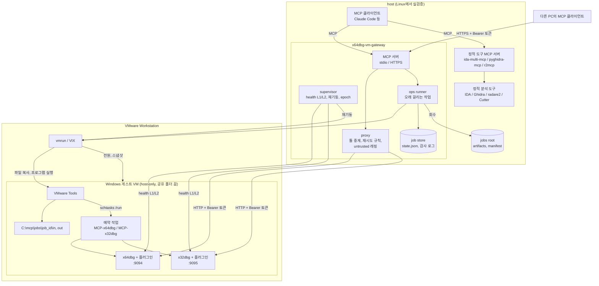
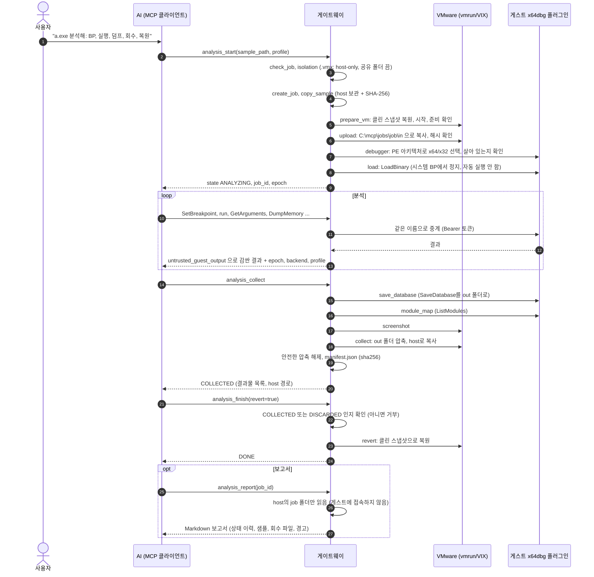
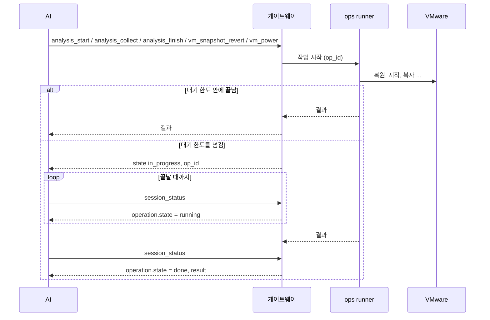
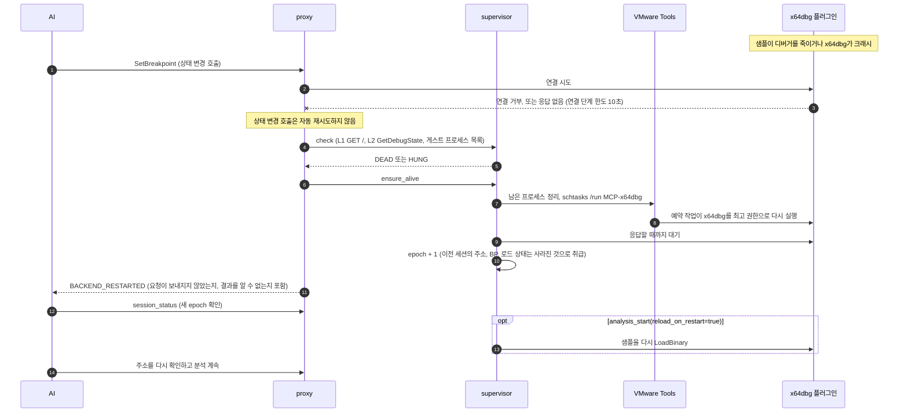
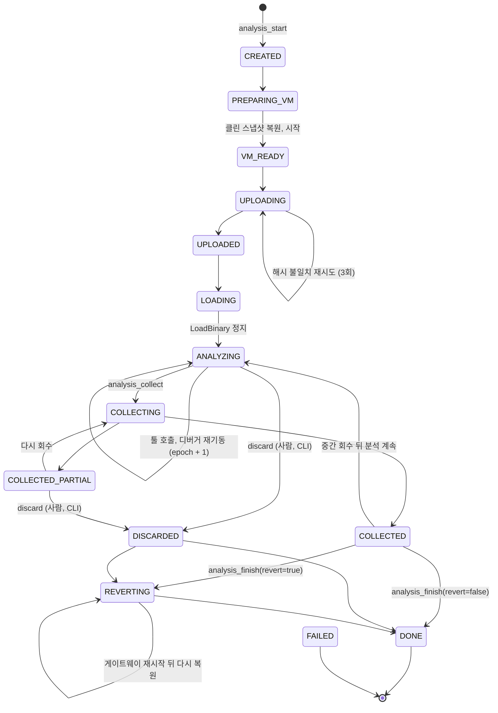
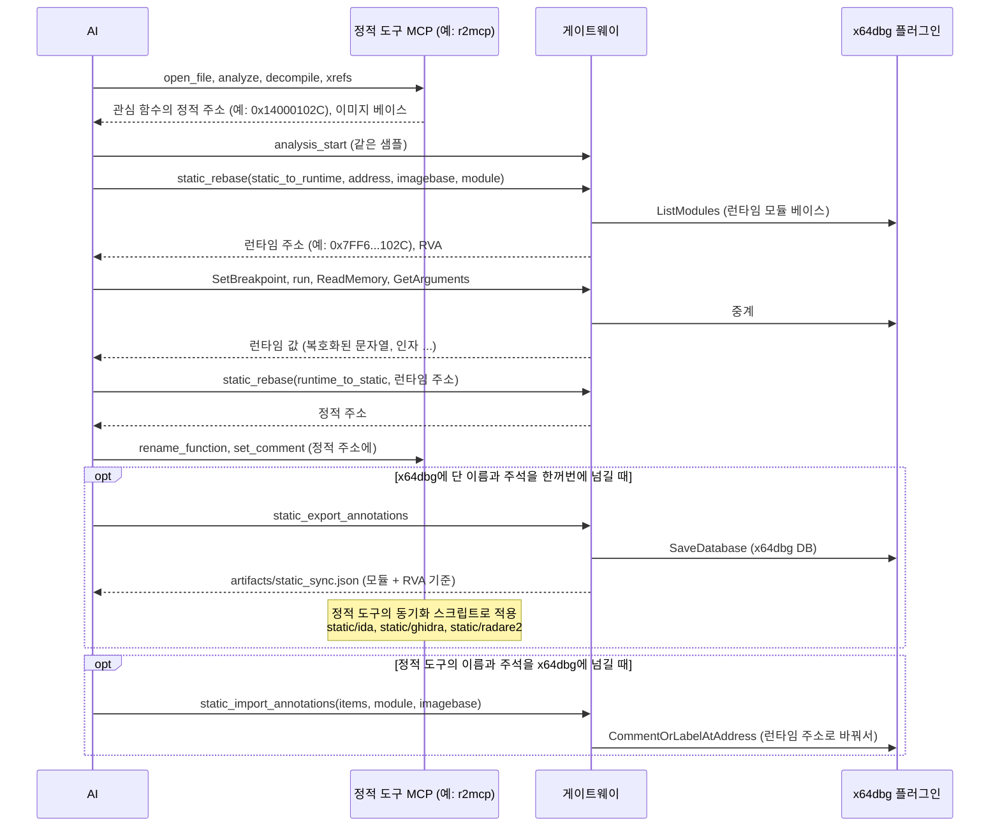
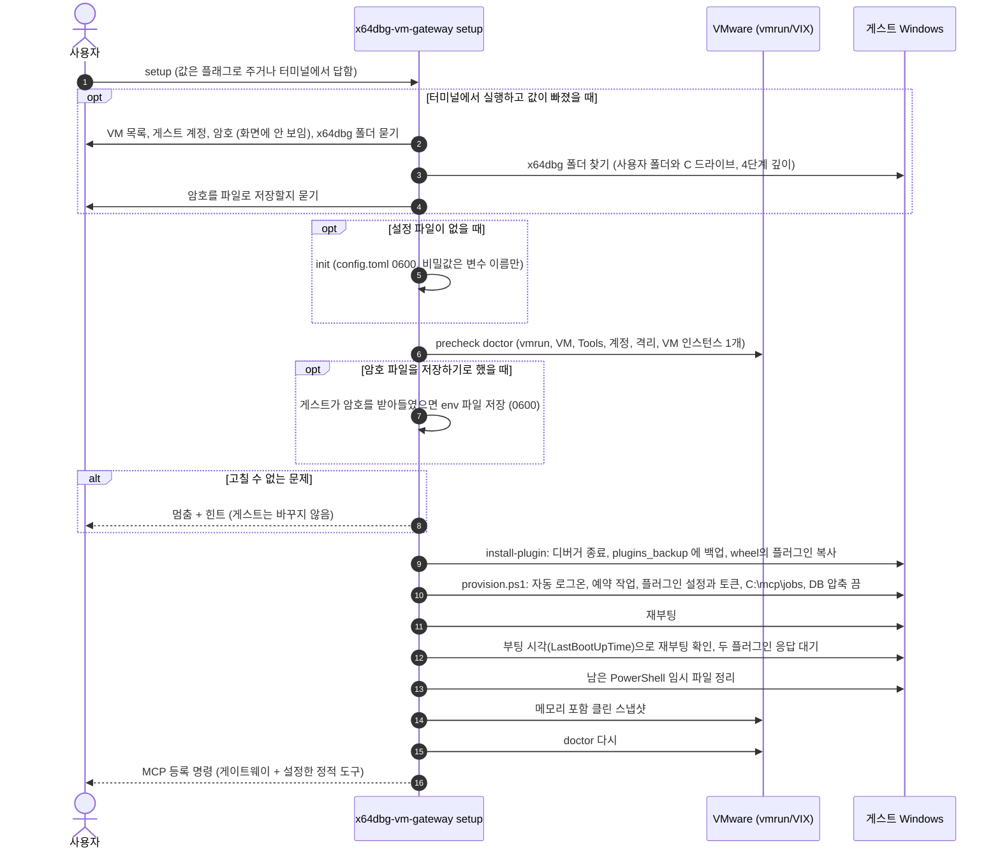
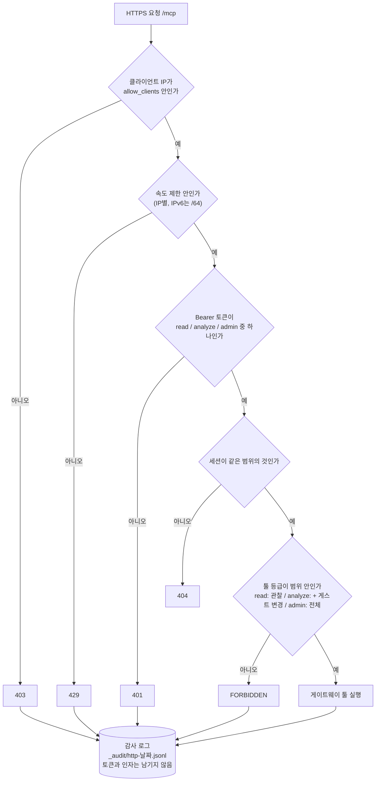

# x64dbg-mcp-server — VMware 분석 루프 포크

> 이 저장소는 [duty1g/x64dbg-mcp-server](https://github.com/duty1g/x64dbg-mcp-server)(MIT)의 **포크**입니다. 원작자의 공식 배포판이 아닙니다.
> 원본의 x64dbg MCP 플러그인을 바탕으로, **host에서 VMware 분석 VM과 디버거를 함께 다루는 MCP 게이트웨이**를 더했습니다. 정적 분석 도구(IDA, Ghidra, radare2, Cutter)와 함께 쓸 수 있습니다.
> 포크 기준점은 upstream `main @ 31c05bc`(플러그인 v1.9)입니다. 라이선스는 [아래](#라이선스)에 정리했습니다.

**English summary.** A fork of duty1g/x64dbg-mcp-server (MIT). It adds `x64dbg-vm-gateway`, a host-side MCP server that reverts a VMware analysis VM to a clean snapshot, uploads the sample, keeps x64dbg/x32dbg alive in the guest, relays the plugin's 83 debugger tools under their original names and collects the artifacts back to the host. A static-analysis tool of your choice (IDA, Ghidra, radare2, Cutter) runs next to it through its own MCP server; the gateway converts addresses between the two sides and exchanges names and comments. One wheel carries the gateway, a prebuilt plugin, the static sync scripts and a benign demo sample; `x64dbg-vm-gateway setup` prepares the guest and takes the clean snapshot, `x64dbg-vm-gateway demo` checks the installation. Releases will be published at <https://github.com/saweol/x64dbg-mcp-server/releases>; until then build the wheel with `scripts/build-release.sh`. English references: [`host/README.md`](host/README.md) (gateway), [`static/README.md`](static/README.md) (static tools) and [`docs/PLUGIN.md`](docs/PLUGIN.md) (plugin). Licensed under MIT like the original; see [License](#라이선스).

---

## 5분 시작

이미 다음이 있다면 아래 명령 몇 줄로 첫 분석까지 갑니다. 시간은 대부분 빌드와 `setup`(실측 약 4분)에 들어갑니다. 처음이라면 [설치 가이드](#설치-가이드)를 순서대로 따라가세요.

- VMware Workstation 17이 있는 Linux host
- [2단계 점검표](#2단계-분석-vm-준비)대로 준비해서 **켜 둔** Windows VM
- [uv](https://docs.astral.sh/uv/)와 Claude Code
- 릴리스가 나오기 전까지는 [Zig 0.14.0](https://ziglang.org/download/#release-0.14.0)(소스에서 빌드할 때 필요)

```bash
# 1. 설치: 릴리스가 나오기 전에는 소스에서 빌드합니다
git clone https://github.com/saweol/x64dbg-mcp-server.git && cd x64dbg-mcp-server
scripts/build-release.sh                          # release/ 에 wheel, 플러그인 zip, SHA256SUMS
(cd release && sha256sum -c SHA256SUMS)
uv tool install release/x64dbg_vm_gateway-*.whl

# 2. 게스트 준비 + 클린 스냅샷 (약 4분)
x64dbg-vm-gateway setup --dry-run                 # 무엇을 할지 먼저 봅니다. 아무것도 바꾸지 않습니다
x64dbg-vm-gateway setup                           # VM, 게스트 계정, 암호, x64dbg 폴더를 묻습니다

# 3. 설치 확인: 무해한 데모 샘플로 분석 한 바퀴를 돕니다
x64dbg-vm-gateway demo

# 4. Claude Code에 등록: Claude Code를 띄울 폴더에서 실행합니다
x64dbg-vm-gateway mcp-config --tool gateway --apply
```

그다음 같은 폴더에서 `claude`를 띄우고 `/mcp`로 `x64dbg-vm`이 연결됐는지 봅니다. 첫 대화는 이렇게 시작합니다.

> x64dbg-vm 게이트웨이 상태를 확인해 줘. session_status와 gateway_doctor만 호출하고, 아무것도 바꾸지 마.

MCP 프롬프트를 슬래시 명령으로 쓸 수도 있습니다(`/mcp__x64dbg-vm__analyze-sample <샘플 경로>`). 자세한 것은 [처음 분석하기](#처음-분석하기)에 있습니다. 샘플은 VM 안에서만 실행됩니다. 회수한 파일은 host에서 실행하지 마세요([안전 수칙](#안전-수칙)).

## 한눈에 보기

AI 클라이언트(Claude Code 등)에는 MCP 서버를 등록합니다.

- **동적 분석:** 이 저장소의 게이트웨이(필수)
- **정적 분석:** 고른 정적 분석 도구의 MCP 서버([선택](#정적-도구는-선택))

```
                         ┌─ x64dbg-vm-gateway (host, Python) ── 동적 분석
Claude Code ──MCP────────┤    ├─ vmrun ──────────► VMware: 전원, 스냅샷, 게스트 파일·프로세스
(원격 PC는 HTTPS)        │    └─ HTTP + Bearer ──► 게스트 x64dbg :9094 / x32dbg :9095 (플러그인 v1.10)
                         │
                         └─ 정적 분석 도구의 MCP 서버 (host, 선택) ── 정적 분석
                              IDA: ida-multi-mcp │ Ghidra: pyghidra-mcp │ radare2: r2mcp
```

두 쪽은 **모듈 + RVA**로 주소를 맞춥니다. 디버거의 런타임 주소는 ASLR로 실행할 때마다 바뀌지만, 모듈 기준 오프셋(RVA)은 같기 때문입니다. 게이트웨이의 `static_rebase`가 이 주소 변환을 하고, `static_export_annotations` / `static_import_annotations`가 이름과 주석을 주고받습니다.

분석 한 바퀴는 다음과 같이 돕니다.

```
analysis_start ──► 분석 (x64dbg 툴 83개 + 정적 도구) ──► analysis_collect ──► analysis_finish
 클린 스냅샷 복원      SetBreakpoint, run, DumpMemory ...      결과물을 host로 회수    클린 스냅샷으로 복원
 샘플 업로드·해시 확인 decompile, rename, static_rebase ...    (덤프, x64dbg DB, zip)
 디버거에 로드(정지 상태)
```

게이트웨이가 AI에게 보여 주는 툴은 게이트웨이 툴 22개와 플러그인 툴 83개, 합계 105개입니다. 실제 Claude Code에서도 105개가 보였습니다([검증 현황](#검증-현황)). 구성 요소, 시퀀스, 상태 전이는 [동작 구조](#동작-구조)에 그림으로 있습니다.

## 필요한 것

| # | 구성 요소 | 어디에 | 내용 | 누가 설치하나 |
|---|---|---|---|---|
| 1 | **게이트웨이** | host | `x64dbg-vm-gateway`. wheel에 플러그인, 정적 동기화 스크립트, 무해한 데모 샘플이 들어 있습니다. | 사용자 ([1단계](#1단계-게이트웨이-설치)) |
| 2 | **동적 분석 환경** | host의 VMware | VMware Workstation 17(`vmrun` 포함)과 Windows 게스트 VM | 사용자 ([2단계](#2단계-분석-vm-준비)) |
| 3 | **게스트의 x64dbg/x32dbg와 MCP 플러그인** | VM 안 | x64dbg(`release\x64\x64dbg.exe`, `release\x32\x32dbg.exe`)와 이 저장소의 플러그인 v1.10 | x64dbg는 사용자가 압축만 풉니다. 플러그인은 `setup`이 배포합니다. |
| 4 | **VMware 클린 스냅샷** | VMware | 디버거와 플러그인이 떠 있는 상태의 메모리 포함 스냅샷 | `setup`이 찍습니다 ([3단계](#3단계-setup으로-게스트-준비와-클린-스냅샷)). |
| 5 | **MCP 클라이언트** | host | Claude Code 등 | 사용자 ([5단계](#5단계-mcp-클라이언트에-등록)) |
| + | **정적 분석 도구** (선택) | host | IDA Pro, Ghidra, radare2, Cutter 중 하나와 그 도구의 MCP 서버 | 사용자 ([정적 도구는 선택](#정적-도구는-선택)) |

host는 Linux에서 실검증했습니다. Windows와 macOS(Intel)는 코드상 지원하지만 실검증 전입니다. Windows host 명령은 [Windows host에서](#windows-host에서-실검증-전)에 따로 정리했습니다.

## 설치 가이드

먼저 전체 흐름입니다. 각 단계의 설명은 아래에 이어집니다.

```bash
uv tool install release/x64dbg_vm_gateway-*.whl  # 1. 게이트웨이(플러그인, 데모 샘플 포함)
#                                                  2. VMware에 Windows VM 준비(수동, 점검표)
x64dbg-vm-gateway setup                          # 3. 게스트 준비 + 클린 스냅샷
x64dbg-vm-gateway demo                           # 4. 설치 확인
x64dbg-vm-gateway mcp-config --tool gateway --apply   # 5. Claude Code 등록
```

### 1단계: 게이트웨이 설치

[uv](https://docs.astral.sh/uv/)가 필요합니다. 게이트웨이는 Python 3.11 이상에서 돌고, 맞는 Python이 없으면 uv가 내려받습니다.

```bash
curl -LsSf https://astral.sh/uv/install.sh | sh     # uv가 없을 때
```

**릴리스 wheel로 설치.** 릴리스는 <https://github.com/saweol/x64dbg-mcp-server/releases>에 올릴 예정입니다. 아직은 올라간 릴리스가 없으니 아래 "소스에서 빌드"를 따르세요. 릴리스가 나오면 wheel과 `SHA256SUMS`를 같은 폴더에 받아 이렇게 설치합니다. 빌드된 플러그인(x64·x32), 정적 동기화 스크립트, 데모 샘플이 들어 있어 Zig가 필요 없습니다.

```bash
sha256sum -c --ignore-missing SHA256SUMS          # 받은 파일의 해시 확인
uv tool install ./x64dbg_vm_gateway-<버전>-py3-none-any.whl
x64dbg-vm-gateway --help
```

**소스에서 빌드.** [Zig 0.14.0](https://ziglang.org/download/#release-0.14.0)이 필요합니다(`ZIG=/path/to/zig`로 지정하거나 PATH에 둡니다). 스크립트가 플러그인과 데모 샘플을 빌드해 wheel에 넣고, `release/`에 다음을 만듭니다.

- wheel과 sdist
- 플러그인 zip(`x64dbg-mcp-plugin-<버전>.zip`)
- `SHA256SUMS`

```bash
scripts/build-release.sh
(cd release && sha256sum -c SHA256SUMS)
uv tool install release/x64dbg_vm_gateway-*.whl   # 다시 설치할 때는 --force
```

설치한 뒤 `x64dbg-vm-gateway`를 찾을 수 없다고 나오면 `uv tool update-shell`을 실행하고 새 셸을 엽니다.

### 2단계: 분석 VM 준비

이 단계만 사람 손이 필요합니다. 아래 점검표를 위에서부터 맞춘 뒤 VM을 켭니다.

**VM 준비 점검표**

| # | 항목 | 할 일 |
|---|---|---|
| 1 | **클론부터** | 이미 쓰는 분석 VM이 있다면 그대로 쓰지 말고 전체 클론(VM > Manage > Clone, Full clone)을 만들어 씁니다. `setup`은 게스트를 바꾸고(자동 로그온, 예약 작업, 플러그인) 재부팅하며, 분석 때마다 스냅샷으로 복원합니다. 새로 만든다면 새 VM에 바로 해도 됩니다. |
| 2 | **Windows** | Windows 10/11. 실검증은 Windows 10 Pro 19045(한국어판, PowerShell 5.1)에서만 했습니다. Windows 11과 Home 에디션은 확인하지 않았습니다. |
| 3 | **계정** | Microsoft 계정이 아닌 **로컬** 관리자 계정 하나. **암호가 있어야** 합니다. 자동 로그온과 게스트 작업에 씁니다. |
| 4 | **암호는 실험실 전용** | 자동 로그온은 암호를 게스트 레지스트리(`HKLM\SOFTWARE\Microsoft\Windows NT\CurrentVersion\Winlogon`의 `DefaultPassword`)에 평문으로 남깁니다. 그래서 **모든 스냅샷에 들어가고, 게스트의 악성코드가 읽을 수 있습니다.** 다른 곳에서 쓰는 암호는 절대 쓰지 마세요. |
| 5 | **UAC** | 실검증한 VM은 관리자 승인 프롬프트가 꺼져 있었습니다(`ConsentPromptBehaviorAdmin=0`). 기본 UAC 설정에서 `setup`이 되는지는 확인하지 않았습니다. |
| 6 | **VMware Tools** | 설치합니다. 게이트웨이가 파일과 프로세스를 다루는 통로입니다. 켠 뒤 `vmrun -T ws checkToolsState /vms/analysis/analysis.vmx`가 `running`이면 됩니다. |
| 7 | **x64dbg** | [x64dbg 릴리스](https://x64dbg.com/)를 압축 해제합니다(예: `C:\x64dbg\release\x64`, `C:\x64dbg\release\x32`). 한 번 실행해 둘 필요는 없습니다. 폴더를 모르면 `setup`이 게스트에서 찾아 줍니다(사용자 폴더와 `C:\`, 4단계 깊이). |
| 8 | **네트워크: host-only** | **host-only가 필요합니다.** 게이트웨이는 게스트의 플러그인에 HTTP로 붙으므로 "연결 없음"으로는 동작하지 않고, bridged·NAT는 격리 점검에 걸립니다. VM 설정의 Network Adapter에서 **Host-only**를 고릅니다. Custom(VMnet1)으로 고르면 `.vmx`에 `custom`으로 적혀 격리 점검에 걸립니다. host-only 네트워크 자체는 Linux에서 `vmware-netcfg`, Windows에서 VMware의 Edit > Virtual Network Editor로 확인합니다. |
| 9 | **공유 폴더: 끔** | VM 설정의 Options > Shared Folders를 Disabled로 둡니다. 드래그 앤 드롭·클립보드 공유도 끄기를 권합니다(게이트웨이가 점검하지는 않음). |
| 10 | **Defender** | 실시간 보호가 업로드한 샘플을 격리하면 분석이 시작되지 않을 수 있습니다. 실험실 VM이라면 `setup` 전에 Windows 보안에서 변조 보호와 실시간 보호를 끄거나 `C:\mcp`를 제외합니다. 실검증한 VM은 실시간 보호가 꺼져 있었습니다. |
| 11 | **업데이트·절전** | Windows Update는 일시 중지하고, 대기 중인 업데이트를 끝낸 상태에서 `setup`을 돌립니다. 클린 스냅샷에 재부팅 대기가 들어가지 않게 하기 위해서입니다. 절전·모니터 끄기는 `setup`이 꺼 둡니다(AC 전원 기준). |
| 12 | **VM 켜기** | 마지막으로 VM을 켜고 로그온 화면이나 바탕 화면까지 기다립니다. `setup`의 점검은 대부분 게스트 안을 봅니다. |

**`.vmx`에서 확인하기.** 8·9번은 격리 점검이 `.vmx` 파일로 판단합니다. VM을 끈 상태에서 확인합니다.

```bash
grep -iE '^(ethernet[0-9]+\.(present|connectionType|startConnected)|sharedFolder[0-9]+\.(present|enabled)|isolation\.tools\.hgfs\.disable) ' \
    /vms/analysis/analysis.vmx
```

다음처럼 나오면 됩니다.

```
ethernet0.present = "TRUE"
ethernet0.connectionType = "hostonly"
isolation.tools.hgfs.disable = "TRUE"
```

- 켜져 있는 모든 네트워크 어댑터가 `connectionType = "hostonly"`여야 합니다. `connectionType` 줄이 없으면 bridged로 봅니다.
- 공유 폴더는 `isolation.tools.hgfs.disable = "TRUE"`이거나, `present`·`enabled`가 켜진 `sharedFolderN` 항목이 없으면 꺼진 것으로 봅니다.
- `.vmx`를 직접 고칠 때는 VM을 끄고 VMware에서 그 VM을 닫은 뒤에 고칩니다.

### 3단계: `setup`으로 게스트 준비와 클린 스냅샷

VM이 켜져 있는 상태에서 실행합니다. 터미널에서 실행하면 빠진 값을 묻습니다.

```bash
x64dbg-vm-gateway setup --dry-run      # 계획만 출력합니다(게스트에 접속하지도, 바꾸지도 않음)
x64dbg-vm-gateway setup
```

묻는 것은 네 가지입니다.

1. **VM:** host에서 찾은 VM 목록에서 번호를 고르거나 `.vmx` 경로를 입력합니다.
2. **게스트 계정:** 로그온해서 디버거를 띄울 Windows 계정입니다.
3. **암호:** 화면에 보이지 않습니다. `X64DBG_GW_GUEST_PW` 환경 변수에 이미 있으면 묻지 않습니다.
4. **x64dbg 폴더:** `x64\`와 `x32\`가 들어 있는 `release` 폴더입니다. 게스트에서 찾아 줄 수 있습니다.

그리고 암호를 파일에 저장할지 묻습니다. 저장하면 매번 환경 변수를 export하지 않아도 됩니다. 파일은 본인만 읽을 수 있는 env 파일(`~/.config/x64dbg-vm-gateway/<프로필>.env`, 0600)이고, **사전 점검에서 게스트가 그 암호를 받아들인 뒤에만** 씁니다. 묻지 않고 저장하려면 `--save-password-file`을, 이미 있는 파일을 고치려면 `--force`를 붙입니다.

값을 미리 주거나 터미널이 아닌 곳에서 돌리려면 플래그로 넘깁니다. 이때는 아무것도 묻지 않습니다.

```bash
read -rs X64DBG_GW_GUEST_PW && export X64DBG_GW_GUEST_PW      # 화면에 표시되지 않습니다
x64dbg-vm-gateway setup --non-interactive --vmx /vms/analysis/analysis.vmx \
    --guest-user analyst --x64dbg-root 'C:\x64dbg\release' --snapshot MCP_CLEAN \
    --save-password-file
```

`setup`은 다음 순서로 진행합니다. 고칠 수 없는 문제가 있으면 게스트를 바꾸기 전에 멈추고, 무엇을 고칠지 알려 줍니다.

1. 설정 파일이 없으면 만듭니다(`init`과 같은 내용). 위치는 `~/.config/x64dbg-vm-gateway/config.toml`(0600)입니다.
2. `doctor`로 vmrun, VM, VMware Tools, 계정, 격리, job 폴더를 점검합니다. 저장하기로 한 암호 파일은 이 점검을 통과한 뒤에 씁니다.
3. wheel에 들어 있는 플러그인을 게스트에 배포합니다. 기존 플러그인은 `plugins_backup\`에 백업합니다.
4. 게스트를 프로비저닝합니다.
   - 자동 로그온을 설정합니다.
   - 로그온 시 디버거를 최고 권한으로 띄우는 예약 작업을 등록합니다.
   - 플러그인 설정과 토큰을 씁니다.
   - 작업 폴더 `C:\mcp\jobs`를 만들고, x64dbg DB 압축과 절전을 끕니다.
5. 재부팅한 뒤 두 플러그인이 응답하면 메모리 포함 클린 스냅샷을 찍습니다(기본 이름 `MCP_CLEAN`).
6. `doctor`로 다시 점검하고, MCP 클라이언트 등록 명령을 출력합니다.

실측으로는 `setup` 전체가 약 4분(248초) 걸렸습니다. 이후 매 분석은 이 스냅샷에서 시작해 이 스냅샷으로 돌아갑니다. 이미 있는 스냅샷 이름으로는 찍지 않습니다. 다시 하려면 `--snapshot 새이름`을 줍니다. 단계별로 따로 하려면 `init`, `install-plugin`, `provision`, `doctor`를 직접 실행해도 됩니다. 절차는 [`docs/QUICKSTART_KO.md`](docs/QUICKSTART_KO.md#부록-a-단계별-수동-설치)에 있습니다.

### 4단계: `demo`로 설치 확인

```bash
x64dbg-vm-gateway demo                 # --arch x64 | x32 | both (기본: 설정된 디버거 모두)
```

wheel에 든 무해한 샘플(메시지를 찍고 `kernel32.Sleep`을 몇 번 부르고 작은 파일을 쓴 뒤 끝나는 프로그램)로 AI가 하는 것과 같은 호출을 차례로 합니다.

```
analysis_start → SetBreakpoint kernel32.Sleep → run (kernel32에서 멈출 때까지, 최대 4번)
→ GetCallStack → analysis_collect → analysis_finish(revert=true)
```

단계마다 걸린 시간을 찍고, 끝에 `PASS` 또는 `FAIL`과 힌트를 냅니다(종료 코드 0 / 1). 끝나면 VM은 클린 스냅샷으로 돌아갑니다. 실패하면 데모가 만든 job만 정리합니다. 설정 파일은 바꾸지 않습니다.

`demo`는 MCP 클라이언트가 게이트웨이를 돌리고 있으면 `LOCK_TIMEOUT`으로 멈춥니다. 그래서 Claude Code에 등록하기 전에, 또는 Claude Code를 닫고 실행합니다. `demo`는 실 VM에서 x64·x32 모두 통과했습니다(92초, [검증 현황](#검증-현황)).

### 5단계: MCP 클라이언트에 등록

`setup`과 `mcp-config`가 출력한 명령을 그대로 실행하거나, `--apply`로 실행하게 합니다.

```bash
x64dbg-vm-gateway mcp-config --tool gateway            # 등록 명령만 출력
x64dbg-vm-gateway mcp-config --tool gateway --apply    # 묻고 나서 claude mcp add 실행 (--yes면 묻지 않음)
claude mcp list
```

- 출력되는 명령은 `claude mcp add x64dbg-vm -- <설치된 실행 파일의 절대 경로> serve` 꼴입니다. 다시 설치해서 경로가 바뀌면 다시 실행합니다. 설정 파일이 기본 위치가 아니면 `-e X64DBG_VM_GATEWAY_CONFIG=<경로>`가 붙습니다.
- `claude mcp add`는 기본으로 **지금 폴더에만**(local 범위) 등록합니다. 다른 폴더에서도 쓰려면 출력된 명령의 `claude mcp add` 바로 뒤에 `--scope user`를 넣어 직접 실행합니다.
- 비밀값을 `claude mcp add -e`로 넘기면 Claude 설정 파일에 기록되니 피합니다. 게스트 암호는 `setup`이 만든 암호 파일이나 셸 환경에 둡니다.
- Claude Desktop, Cursor, VS Code처럼 JSON으로 설정하는 클라이언트는 `mcp-config --client json`이 `mcpServers` 문서를 출력합니다.
- 툴 승인 설정은 [권한 설정](#권한-설정)을 보세요.

### Windows host에서 (실검증 전)

Windows host는 코드상 지원하지만 **실제 Windows host에서 돌려 보지 않았습니다.** 아래 PowerShell 명령도 확인하지 않은 것입니다. 게이트웨이가 출력하는 등록 명령은 Windows에서 PowerShell 인용으로 나옵니다(단위 테스트만).

| 작업 | Linux (실검증) | Windows PowerShell (미검증) |
|---|---|---|
| uv 설치 | `curl -LsSf https://astral.sh/uv/install.sh \| sh` | `powershell -ExecutionPolicy ByPass -c "irm https://astral.sh/uv/install.ps1 \| iex"` |
| 해시 확인 | `sha256sum -c --ignore-missing SHA256SUMS` | `Get-FileHash .\x64dbg_vm_gateway-<버전>-py3-none-any.whl -Algorithm SHA256`의 값을 `SHA256SUMS`와 비교 |
| 게이트웨이 설치 | `uv tool install ./x64dbg_vm_gateway-<버전>-py3-none-any.whl` | `uv tool install .\x64dbg_vm_gateway-<버전>-py3-none-any.whl` |
| 명령을 못 찾을 때 | `uv tool update-shell` | `uv tool update-shell` 후 새 PowerShell 창 |
| 설정 파일 | `~/.config/x64dbg-vm-gateway/config.toml` | `$env:APPDATA\x64dbg-vm-gateway\config.toml` |
| 암호 파일(`setup` 기본값) | `~/.config/x64dbg-vm-gateway/<프로필>.env` (0600) | `$env:APPDATA\x64dbg-vm-gateway\<프로필>.env` (icacls로 본인만) |
| 암호: 이 셸에서만 | `read -rs X64DBG_GW_GUEST_PW && export X64DBG_GW_GUEST_PW` | PowerShell 7.1 이상: `$env:X64DBG_GW_GUEST_PW = Read-Host 'guest password' -MaskInput`<br>Windows PowerShell 5.1: `$s = Read-Host 'guest password' -AsSecureString; $env:X64DBG_GW_GUEST_PW = [Net.NetworkCredential]::new('', $s).Password` |
| 암호: 계속 쓰기 | `setup --save-password-file` | `setup --save-password-file` (권장). 사용자 환경 변수(`[Environment]::SetEnvironmentVariable(..., 'User')`)는 레지스트리에 평문으로 남으니 권하지 않습니다. |
| 다른 설정 파일 쓰기 | `export X64DBG_VM_GATEWAY_CONFIG=/path/config.toml` | `$env:X64DBG_VM_GATEWAY_CONFIG = 'C:\lab\config.toml'` |
| job 폴더(기본) | `~/mcp-lab/jobs` | `$env:USERPROFILE\mcp-lab\jobs` |
| vmrun | `/usr/bin/vmrun` | `init`·`setup`이 레지스트리와 설치 폴더에서 찾습니다(보통 `C:\Program Files (x86)\VMware\VMware Workstation\vmrun.exe`). 못 찾으면 `--vmrun PATH`. |
| host-only 네트워크 | `vmware-netcfg` | VMware Workstation: Edit > Virtual Network Editor |
| `.vmx` 확인 | `grep -iE '...' /vms/analysis/analysis.vmx` | `Select-String -Path D:\vms\analysis\analysis.vmx -Pattern '^(ethernet\d+\.(present\|connectionType)\|sharedFolder\d+\.(present\|enabled)\|isolation\.tools\.hgfs\.disable) '` |
| 회수한 결과물 | `artifacts/files/`에 풀어 둠 | 기본으로 풀지 않고 `artifacts/raw/out.zip`으로만 둡니다(`analysis_collect(extract=true)`로 풀 수 있음). |

## 처음 분석하기

Claude Code에서 아래 세 프롬프트를 순서대로 써 보세요. 처음 두 개는 무엇을 하는지 눈으로 보기 위한 것입니다.

**1. 상태 확인(아무것도 바꾸지 않음)**

> x64dbg-vm 게이트웨이 상태를 확인해 줘. session_status와 gateway_doctor만 호출하고, VM 전원, 디버거 응답, 격리, 클린 스냅샷 상태를 표로 정리해. 아무것도 바꾸지 마.

**2. 무해한 샘플로 한 바퀴.** 소스에서 빌드했다면 데모 샘플이 저장소의 `host/src/x64dbg_vm_gateway/data/samples/`에 있습니다(릴리스 wheel이라면 설치된 패키지의 `x64dbg_vm_gateway/data/samples/`). 샘플은 `gateway.upload_roots`(기본: 홈 폴더) 안에 있어야 합니다. 저장소 폴더에서 복사합니다.

```bash
mkdir -p ~/samples && cp host/src/x64dbg_vm_gateway/data/samples/e2e_sample_x86_64.exe ~/samples/hello64.exe
```

> `~/samples/hello64.exe` 분석을 시작해. kernel32.Sleep에 BP를 걸고 run으로 거기서 멈추면 콜 스택과 인자를 보여 줘. 그다음 analysis_collect로 회수하고 analysis_finish로 복원한 뒤, analysis_report로 무엇을 했는지 정리해.

**3. 실제 샘플**

> `~/samples/<샘플>.exe` 분석을 시작해. 바로 실행하지 말고 먼저 GetImports, GetStrings, GetMemoryMap으로 무엇을 할 것 같은지 정리해. 그다음 kernel32.CreateFileW, kernel32.WriteFile, ws2_32.connect에 BP를 걸고 run으로 진행하면서 호출마다 인자와 호출 위치를 기록해. 수상한 메모리 영역은 DumpMemory로 job의 out 폴더에 저장해. 끝나면 analysis_collect로 회수하고, 복원하기 전에 나에게 물어봐. 마지막에 analysis_report로 보고서를 써.

AI는 대략 다음 순서로 툴을 호출합니다.

1. `analysis_start`: 격리를 점검하고 클린 스냅샷으로 복원합니다. 샘플을 해시 확인과 함께 올리고, 아키텍처에 맞는 디버거에 정지 상태로 로드합니다. 샘플을 자동으로 실행하지는 않습니다.
2. `SetBreakpoint` → `run` → `GetArguments` → `DumpMemory`: 상대 경로로 지정한 덤프는 job의 게스트 `out` 폴더에 저장됩니다.
3. `analysis_collect`: x64dbg DB를 저장하고 `out`을 묶어 host로 가져온 뒤, 안전하게 풀고 manifest를 돌려줍니다.
4. `analysis_finish`: 클린 스냅샷으로 복원합니다. 회수 전에는 거부됩니다.

### MCP 프롬프트(슬래시 명령)

게이트웨이는 분석 계획을 담은 MCP 프롬프트 5개를 내놓습니다. 실제 툴 이름과 안전 수칙이 들어 있어, 긴 지시를 직접 쓰지 않아도 됩니다.

| 프롬프트 | 인자(순서대로) | 하는 일 |
|---|---|---|
| `analyze-sample` | `sample_path`, `arch`(선택) | 시작 → 살펴보기 → 관심 API까지 실행 → 회수 → 보고 → 종료 |
| `trace-api` | `sample_path`, `api`(예: `kernel32.CreateFileW`), `arch`(선택) | API 하나에 BP를 걸고 모든 호출의 인자, 호출 위치, 결과를 기록 |
| `find-oep` | `sample_path`, `arch`(선택) | 언패킹: `VirtualAlloc`/`VirtualProtect`에 BP, 새 영역 실행 감시, `DetectOEP`, 덤프 |
| `static-dynamic` | `sample_path`, `static_address`, `imagebase`, `module`(선택), `arch`(선택) | 정적 도구의 주소 → `static_rebase` → BP → 결과를 정적 도구에 다시 남김 |
| `report` | `job_id`(선택) | `analysis_report`로 job 요약 |

Claude Code에서는 `/`를 치면 `/x64dbg-vm:analyze-sample (MCP)`처럼 보이고, `/mcp__x64dbg-vm__analyze-sample`로 실행합니다. 가운데 `x64dbg-vm`은 `claude mcp add`에 준 서버 이름입니다. 인자는 공백으로 나눠 순서대로 넘깁니다. 그래서 경로에 공백이 없어야 합니다.

```
/mcp__x64dbg-vm__analyze-sample /home/analyst/samples/hello64.exe
/mcp__x64dbg-vm__trace-api /home/analyst/samples/a.exe kernel32.CreateFileW
/mcp__x64dbg-vm__report
```

`arch`는 `auto`(기본, PE 헤더로 판단), `x64`, `x32` 중 하나입니다. 잘못된 인자는 `INVALID_PARAMS`로 거부됩니다. 실제 Claude Code에서 프롬프트 5개가 이 이름의 슬래시 명령으로 보였고, `report`를 실행해 봤습니다. 나머지 4개를 끝까지 실행한 결과는 아직 확인하지 않았습니다.

## 결과 보기

**보고서.** AI에게는 `analysis_report`를, 사람은 CLI를 씁니다. CLI는 게이트웨이가 돌고 있어도 읽을 수 있습니다.

```bash
x64dbg-vm-gateway jobs list                                    # job id 찾기
x64dbg-vm-gateway jobs report <JOB_ID>                         # Markdown 보고서 출력
x64dbg-vm-gateway jobs report <JOB_ID> --out ~/mcp-lab/jobs/<JOB_ID>/artifacts/report.md
x64dbg-vm-gateway jobs report <JOB_ID> --format json
```

보고서에는 상태 이력과 시각, 샘플(이름, 크기, sha256, 아키텍처), epoch와 디버거 재기동, 회수한 파일(게스트 원래 경로, 크기, sha256, host 경로), 모듈 맵, 화면 캡처, 정적 도구 내보내기, 경고와 오류가 들어갑니다. 게스트에서 온 이름과 메시지는 `<untrusted_guest_output>` 블록 안에 둡니다. `--out`은 0600으로 쓰고, 이미 있는 파일은 `--force`일 때만 바꿉니다. 보고서는 실제 job으로 `jobs report`와 Claude Code의 `analysis_report` 호출에서 확인했습니다.

**결과물 폴더.** 회수한 파일은 `~/mcp-lab/jobs/<job_id>/artifacts/`에 쌓입니다(전체 구조는 [host에 남는 것](#host에-남는-것)).

| 경로 | 내용 |
|---|---|
| `manifest.json` | 회수 기록. 아래 표 |
| `files/NNNN_<sha12>` | 풀어 놓은 파일. 이름은 해시 기반이고, 원래 이름은 manifest에만 있습니다. |
| `raw/out.zip` | 게스트 `out` 폴더를 받은 그대로의 압축 |
| `static_sync.json`, `static_sync.dd64` | `static_export_annotations` 결과 |

`manifest.json`의 주요 필드입니다.

| 필드 | 뜻 |
|---|---|
| `collected_at` | 회수 시각 |
| `guest_out_dir`, `guest_job_dir` | 게스트의 `out` 폴더와 job 폴더 |
| `raw_zip`, `raw_zip_sha256`, `raw_zip_size` | 받은 압축 파일과 그 해시·크기 |
| `archive_method`, `archive_attempts` | 게스트에서 묶은 방법(`compress-archive`, `tar`, `copy`)과 시도 기록 |
| `extracted` | `files/`에 풀었는지 |
| `partial`, `errors` | 일부만 회수됐는지와 그 이유. `partial`이면 job이 `COLLECTED_PARTIAL`이 되고 복원이 막힙니다. |
| `entries[]` | 파일마다 `source`(`out`/`extra`), `original_path`, `stored_name`, `size`, `sha256`, `status`(`ok`, `archived`, `skipped:…`, `rejected:…`, `failed:…`) |
| `module_map` | 회수 시점의 모듈 맵(`ListModules`) |
| `screenshot` | 회수 시점의 게스트 화면 캡처 |

x64dbg DB(`.dd64`/`.dd32`)가 어느 파일인지는 `entries[]`의 `original_path`로 찾습니다.

```bash
jq -r '.entries[] | select(.original_path | test("\\.dd(64|32)$")) | .stored_name' \
    ~/mcp-lab/jobs/<JOB_ID>/artifacts/manifest.json
```

**x64dbg DB 열기.** DB는 JSON입니다(`setup`이 압축을 끕니다). x64dbg에서 같은 샘플을 연 뒤, 명령 창에 `dbload <파일 경로>`를 입력하면 라벨·주석·BP를 불러옵니다. 이 명령은 x64dbg의 기능이고, 이 저장소에서 따로 확인하지는 않았습니다. DB도 게스트에서 온 데이터이므로 분석 VM 안에서 여는 것을 권합니다. 정적 도구로 넘기려면 `static_export_annotations`가 만든 `static_sync.json`을 쓰는 편이 쉽습니다([정적 도구는 선택](#정적-도구는-선택)).

**감염된 상태 남기기.** `analysis_finish(keep_snapshot=true)`는 복원하기 전에 그 상태를 스냅샷 `gw-job-<id>`로 남깁니다. 나중에 `vm_snapshot_revert`로 돌아가 볼 수 있습니다. 쌓인 스냅샷은 [`snapshot prune`](#클린-스냅샷-갱신과-정리)으로 정리합니다.

**게스트 화면.** `vm_screenshot`은 게스트 화면을 host에 PNG로 저장합니다(진행 중인 job이 있으면 그 job의 폴더). 디버거가 응답하지 않을 때 대화 상자나 로그온 화면에 멈춰 있는지 확인하는 데 씁니다. `analysis_collect`도 회수할 때 한 장 찍습니다.

회수한 파일은 공격자가 만든 데이터로 다룹니다. host에서 실행하지 않습니다.

## 권한 설정

Claude Code는 툴마다 사용 여부를 묻습니다. `mcp-config --permissions`는 게이트웨이 툴을 위한 `settings.json` 권한 조각을 출력합니다. 툴 이름은 `mcp__x64dbg-vm__<툴>` 꼴입니다.

```bash
x64dbg-vm-gateway mcp-config --permissions > x64dbg-permissions.json                        # strict (기본)
x64dbg-vm-gateway mcp-config --permissions --permissions-mode lab > x64dbg-permissions.json  # lab
```

출력은 `{"permissions": {"allow": [...], "ask": [...]}}`입니다. 이것을 `.claude/settings.json`(이 프로젝트)이나 `~/.claude/settings.json`(모든 프로젝트)의 `permissions`에 합칩니다. 이미 있는 목록은 지우지 말고 항목을 더합니다.

| 모드 | 묻지 않고 실행 | 매번 물음 | 언제 쓰나 |
|---|---|---|---|
| `strict` (기본) | 관찰 툴, `analysis_start`, `analysis_collect`, `file_upload`, `static_*`, 플러그인의 읽기 전용 툴 | 디버기를 바꾸는 툴(`SetBreakpoint`, `run`, step, `WriteMemToAddress`, `ExecuteDebuggerCommand`, `DumpMemory` …), `debugger_call`, `debugger_select`, `debugger_restart`, host·VM 파괴적 툴 | 처음 쓸 때, 무엇을 하는지 보면서 |
| `lab` | 게스트만 바꾸는 툴 모두(`debugger_call`, `ExecuteDebuggerCommand` 포함) | host·VM 파괴적 툴 6개(`vm_snapshot_take`, `vm_snapshot_revert`, `vm_snapshot_delete`, `vm_power`, `file_download`, `analysis_finish`) | 매 job 뒤 복원하는 버려도 되는 실험실 VM |

플러그인 v1.10 기준으로 strict는 허용 51개·물음 54개, lab은 허용 99개·물음 6개입니다. `endpoint` 프로필은 늘 strict입니다. 정적 도구의 MCP 서버는 이 조각에 들어 있지 않습니다. 이 기능은 단위 테스트로만 검증했습니다.

## 정적 도구는 선택

게이트웨이만으로도 동적 분석은 됩니다. 정적 도구를 붙이면 AI가 정적 분석으로 함수를 찾고, 디버거로 값을 확인하고, 그 결과를 다시 정적 DB에 남길 수 있습니다.

쓸 도구를 설정 파일(`~/.config/x64dbg-vm-gateway/config.toml`)에 적습니다. `[static]`이 없으면 기본은 IDA(ida-multi-mcp)입니다. 여러 개를 적으면 첫 번째가 기본 도구입니다.

```toml
[static]
tools = ["radare2"]          # "ida", "ghidra", "radare2", "cutter" 중에서
```

**가장 쉬운 시작: radare2.** 등록 명령에 채울 값이 없어서 바로 등록할 수 있습니다.

```bash
r2pm -ci r2mcp                                          # radare2가 PATH에 있어야 합니다
x64dbg-vm-gateway mcp-config --tool radare2 --apply     # claude mcp add radare2 -- r2pm -r r2mcp
```

**Ghidra: 바이너리마다 등록.** pyghidra-mcp는 시작할 때 분석할 바이너리를 인자로 받습니다. 그래서 등록 명령에 `<binary>`, `<project-dir>` 같은 자리 표시가 남고, 바이너리가 바뀌면 다시 등록합니다. `--set`으로 채웁니다.

```bash
x64dbg-vm-gateway mcp-config --tool ghidra \
    --set binary=/home/analyst/samples/a.exe --set project-dir=/home/analyst/ghidra-projects \
    --set project-name=lab --set ghidra-install-dir=/opt/ghidra_12.2_PUBLIC --set jdk25-home=/opt/jdk-25 \
    --apply
claude mcp remove ghidra      # 다른 바이너리로 바꾸기 전에 (이미 등록된 이름은 --apply가 건너뜁니다)
```

매번 채우기 번거로우면 설정 파일에 고정해 둘 수 있습니다. 토큰·암호 같은 비밀값은 이 설정에 넣을 수 없습니다(거부됨). 비밀값은 그 MCP 서버 자체의 설정이나 환경에 둡니다.

```toml
[static.servers.ghidra]
command = ["/opt/pyghidra-venv/bin/pyghidra-mcp", "--transport", "stdio",
           "--project-path", "/work/ghidra-projects", "--project-name", "lab",
           "--wait-for-analysis", "/work/samples/a.exe"]
env = { GHIDRA_INSTALL_DIR = "/opt/ghidra_12.2_PUBLIC", JAVA_HOME = "/opt/jdk-25" }
```

| 도구 | 설치 | MCP 서버 | 동기화 스크립트 | 검증한 버전 |
|---|---|---|---|---|
| radare2 | [radare2](https://github.com/radareorg/radare2/releases) | [r2mcp](https://github.com/radareorg/radare2-mcp): `r2pm -ci r2mcp`, 등록 명령 `r2pm -r r2mcp` | `static/radare2/x64dbg_sync_r2.py` (r2pipe) | radare2 6.2.6, r2mcp 1.9.0 |
| Ghidra | [Ghidra](https://github.com/NationalSecurityAgency/ghidra/releases) 압축 해제 + JDK(Ghidra 12.2는 JDK 25) | [pyghidra-mcp](https://github.com/clearbluejar/pyghidra-mcp)(헤드리스, 기본). 대안: [GhidraMCP](https://github.com/LaurieWired/GhidraMCP) | `static/ghidra/x64dbg_sync_ghidra.py` (`pyghidraRun -H`로 실행) | Ghidra 12.2, pyghidra-mcp 0.3.0, GhidraMCP 2.0 |
| IDA Pro | 상용 설치본 | ida-multi-mcp(별도 설치): `python3 -m ida_multi_mcp` | `static/ida/x64dbg_sync.py` | IDA 9.2 |
| Cutter | [Cutter](https://cutter.re/) | 기본 등록 없음(아래 주의 참고) | `static/radare2/x64dbg_sync_r2.py` (Cutter의 Python에서 실행) | Cutter 2.5.0, 2.4.1 |

`mcp-config`(옵션 없이)는 게이트웨이와 설정한 모든 정적 도구의 등록 명령을 출력합니다. 사용자마다 다른 값은 `<...>`로 남고 `fill in`에 목록이 나옵니다. `x64dbg-vm-gateway static-scripts --dest ~/x64dbg-static`은 동기화 스크립트를 원하는 폴더로 복사합니다.

도구별로 알아 둘 점은 다음과 같습니다.

- **Ghidra:**
  - Python 동기화 스크립트는 일반 `analyzeHeadless`로는 돌지 않습니다. `pyghidraRun -H`로 실행합니다.
  - pyghidra-mcp는 `--wait-for-analysis`를 주면 분석이 끝난 뒤에야 첫 응답을 합니다. 큰 바이너리는 Claude Code의 시작 대기 시간을 늘립니다(`MCP_TIMEOUT=120000 claude`, 밀리초).
- **radare2:** r2mcp에는 프로젝트 저장 툴이 없습니다. 서버가 끝나면 이름과 주석도 사라집니다. 남기려면 동기화 스크립트(`--project`)로 프로젝트에 적용합니다.
- **Cutter:** 공개된 CutterMCP 2.0은 그대로 쓰면 **위험합니다.**
  - Cutter 플러그인이 모든 인터페이스의 8000번 포트에 인증 없이 바인드합니다.
  - 요청 값을 이스케이프하지 않고 rizin 명령에 넣습니다. 셸 명령(`!`)까지 실행될 수 있습니다.
  - 주석 기능도 고장 나 있습니다.

  그래서 기본 등록을 두지 않았습니다. Cutter에서는 동기화 스크립트를 쓰고, AI가 정적 분석을 하게 하려면 같은 바이너리에 radare2의 r2mcp를 붙이기를 권합니다. Cutter 2.5.0 Qt6 AppImage는 Python 플러그인을 읽지 못합니다(rizinorg/cutter#3659). 스크립트는 Cutter의 Python 콘솔에서 실행합니다.

각 스크립트의 사용법은 [`static/README.md`](static/README.md)에 있습니다.

### 정적 분석과 함께 쓰는 흐름

> radare2에서 `a.exe`의 설정 복호화 함수를 찾아. 그 함수가 끝나는 지점에 x64dbg BP를 걸고 실행해서 복호화된 문자열을 읽고, 알아낸 이름과 값을 radare2 주석으로 남겨.

1. 정적 MCP(예: r2mcp)의 디컴파일, 심볼 검색으로 함수를 찾습니다. 주소는 정적 이미지 베이스 기준입니다(예: `0x140001234`).
2. `analysis_start`로 동적 분석을 시작합니다.
3. `static_rebase(direction="static_to_runtime", address="0x140001234")`로 런타임 주소를 얻습니다.
4. `SetBreakpoint` → `run` → `ReadMemory` / `GetArguments`로 값을 읽습니다.
5. 정적 MCP의 `rename_function` / `set_comment`로 결과를 남깁니다. 런타임에서 찾은 주소는 `static_rebase(direction="runtime_to_static")`로 바꿔 씁니다.
6. x64dbg에 단 라벨·주석·BP를 한꺼번에 넘기려면 `static_export_annotations`로 문서를 만들고, 정적 도구의 동기화 스크립트로 적용합니다. 반대 방향은 정적 도구에서 내보낸 항목을 `static_import_annotations`로 x64dbg에 적용합니다.
7. `analysis_collect` → `analysis_finish`로 회수하고 복원합니다.

같은 흐름은 MCP 프롬프트 `static-dynamic`으로도 시작할 수 있습니다.

## VM 여러 대

게이트웨이 하나(`serve` 하나)가 설정의 모든 프로필을 다룹니다. 프로필 하나가 VM 하나이고, VM마다 job을 하나씩 동시에 돌릴 수 있습니다. VM마다 잠금, 작업 실행기, 디버거 감시, epoch가 따로 있어서, 한 VM의 복원이나 디버거 재기동이 다른 VM을 기다리게 하거나 건드리지 않습니다. 이 기능은 단위 테스트로만 검증했습니다(두 번째 VM이 아직 없습니다).

**프로필 더하기.** `config.toml`의 `[profiles.<이름>]`과 그 `backends` 절을 복사해 새 이름으로 바꾸고, `vmx`, `clean_snapshot`, `protected_snapshots`, `guest_user`, `guest_password_env`를 그 VM에 맞춥니다. 그 VM은 `setup --profile <이름>`으로 준비합니다. 첫 `setup`이 만든 암호 파일(`gateway.env_file`)에 그 VM의 암호 줄을 더하려면 `--save-password-file --force`를 붙입니다. 다른 줄은 그대로 둡니다.

```toml
[gateway]
default_profile = "win10"

[profiles.win10]
vmx = "/vms/analysis/analysis.vmx"
# ...

[profiles.win11]
vmx = "/vms/analysis-11/analysis-11.vmx"
guest_password_env = "X64DBG_GW_GUEST_PW_WIN11"
# ...
```

**AI가 VM을 고르는 법.**

- `analysis_start(sample_path=..., profile="win11")`이 그 VM을 이 세션의 대상(target)으로 정합니다.
- `debugger_select(profile="win10")`으로 대상을 바꿉니다. `backend_id`(`x64`/`x32`)로 디버거도 고를 수 있습니다.
- 대상이 없을 때 플러그인 툴은 세션의 대상 → 프로필이 하나뿐이면 그것 → 진행 중인 job이 하나뿐이면 그 VM → 기본 프로필 순서로 보냅니다. VM을 바꾸는 툴(`vm_snapshot_*`, `vm_power`, `debugger_restart`, `analysis_start`)은 "진행 중인 job" 단계를 건너뜁니다.
- 여러 VM에 job이 진행 중이고 대상이 없으면 `TARGET_AMBIGUOUS`로 거부합니다. 아무것도 보내지 않습니다. 오류에 job 목록과 `debugger_select` 호출이 들어 있습니다.
- 플러그인 툴 결과 끝에는 `[gateway] epoch=N backend=ID profile=NAME retried=...` 줄이 붙어, 어느 VM의 결과인지 알 수 있습니다.
- strict 권한에서는 `debugger_select`가 "매번 물음"입니다.

> win10 VM에서는 `~/samples/a.exe`를, win11 VM에서는 `~/samples/b.exe`를 분석해. analysis_start에 profile을 주고, 결과마다 끝줄의 profile을 확인해.

## 클린 스냅샷 갱신과 정리

게스트에 도구를 더 깔거나 x64dbg를 바꿨다면 클린 스냅샷을 새로 찍습니다. 둘 다 **사람만** 하는 CLI 명령이고, MCP 툴은 없습니다. MCP 클라이언트가 게이트웨이를 돌리고 있으면 `LOCK_TIMEOUT`으로 멈추니 Claude Code를 닫고 실행합니다. `snapshot prune`의 미리 보기는 실 VM에서 확인했습니다. 실제 삭제(`--yes`)와 `snapshot refresh`는 단위 테스트로만 검증했습니다.

```bash
x64dbg-vm-gateway snapshot refresh --name MCP_CLEAN_2 --set-clean   # 지금 게스트 상태로 새 클린 스냅샷
x64dbg-vm-gateway snapshot prune --keep 2                           # 지울 후보만 보여 줌
x64dbg-vm-gateway snapshot prune --keep 2 --yes                     # 실제로 지움
```

- `snapshot refresh`는 찍기 전에 끝나지 않은 job이 없는지, VM 인스턴스가 하나인지, 두 플러그인이 응답하는지(`--wait-ready`, 기본 60초) 확인합니다. 이미 있는 스냅샷을 바꾸지 않습니다.
- `--set-clean`은 설정의 `clean_snapshot`과 `protected_snapshots`를 새 이름으로 바꿉니다. `init`이나 `setup`이 쓴 설정 파일만 고치고, 다른 파일이면 넣을 줄을 출력합니다. 예전 클린 스냅샷은 보호 목록에서 빠집니다.
- `snapshot prune`은 게이트웨이가 만든 `gw-*` 스냅샷과, 게이트웨이가 기록한 예전 클린 스냅샷 가운데 종류별로 최신 N개를 뺀 나머지를 보여 줍니다. `--yes`일 때만 지웁니다. 현재 클린 스냅샷, 보호 스냅샷, 끝나지 않은 job의 스냅샷, 게이트웨이가 만들거나 기록하지 않은 스냅샷은 지우지 않습니다.
- 플러그인을 새로 빌드해 넣을 때는 `setup --snapshot 새이름`을 쓰고, 설정의 `clean_snapshot`을 그 이름으로 바꿉니다.

## 알아 두면 좋은 동작

- **오래 걸리는 작업**(`analysis_start`, 복원, 전원)은 정해진 시간이 지나면 `{"state": "in_progress"}`를 돌려주고 백그라운드에서 계속합니다. 진행 상황은 `session_status`로 확인합니다.
- **디버거가 죽으면** 게이트웨이가 다시 띄웁니다. 다음 상태 변경 호출은 `BACKEND_RESTARTED`를 받고, `session_status`로 확인한 뒤 이어서 진행합니다. `analysis_start(reload_on_restart=true)`를 주면 샘플도 다시 로드합니다.
- **목록에 없는 플러그인 툴**은 `debugger_call`로 부를 수 있습니다.
- **주석이 하나도 없는 세션**에서는 x64dbg가 DB 파일을 쓰지 않습니다. 그래서 `static_export_annotations`는 빈 문서와 그 사실을 알리는 경고를 돌려줍니다.
- **샘플 경로**는 `gateway.upload_roots`(기본: 홈 폴더) 안이어야 합니다. 밖이면 `PATH_NOT_ALLOWED`입니다. `setup --upload-root DIR`이나 설정으로 바꿉니다.
- **게이트웨이는 jobs root마다 하나만** 돌 수 있습니다. Claude Code 창을 둘 띄우면 두 번째 창의 게이트웨이는 시작하지 못합니다. 같은 게이트웨이를 여러 클라이언트가 쓰려면 [원격 접속](#다른-pc에서-접속)을 씁니다.

## 게이트웨이 툴 (22개)

| 등급 | 툴 |
|---|---|
| 관찰(읽기 전용) | `session_status`, `gateway_doctor`, `vm_snapshots_list`, `vm_screenshot`, `static_rebase`, `jobs_list`, `jobs_show`, `analysis_report` |
| 게스트 변경 | `file_upload`, `debugger_select`, `debugger_restart`, `debugger_call`, `analysis_start`, `analysis_collect`, `static_export_annotations`, `static_import_annotations` |
| host·VM 파괴적 | `vm_snapshot_take`, `vm_snapshot_revert`, `vm_snapshot_delete`, `vm_power`, `file_download`, `analysis_finish` |

마지막 등급은 MCP 클라이언트의 권한 설정에서 **사람의 승인을 받도록** 둡니다([권한 설정](#권한-설정)). 오류는 `{code, message, stage, retryable, hint, next_tool, details}` 형태로 돌아오므로 AI가 다음 행동을 정할 수 있습니다([오류 코드](#오류-코드)). 예전 이름 `ida_rebase`, `ida_export_annotations`, `ida_import_annotations`도 당분간 호출할 수 있습니다(목록에는 나오지 않음). 게이트웨이는 이 밖에 MCP 프롬프트 5개를 내놓습니다([MCP 프롬프트](#mcp-프롬프트슬래시-명령)).

## CLI

| 명령 | 용도 |
|---|---|
| `setup` | 설정 → 점검 → 플러그인 배포 → 프로비저닝 → 클린 스냅샷 → 등록 명령 출력. 터미널에서는 빠진 값을 묻습니다. `--dry-run`, `--non-interactive`, `--skip-plugin`, `--skip-provision`, `--snapshot NAME`, `--save-password-file [PATH]`, `--force`, `--upload-root DIR` |
| `demo [--arch x64\|x32\|both]` | 데모 샘플로 설치 자가 점검. 끝나면 VM을 클린 스냅샷으로 복원 |
| `mcp-config` | 게이트웨이와 설정한 정적 도구의 MCP 등록 명령 출력. `--tool ID`, `--set NAME=VALUE`, `--apply [--yes]`, `--client claude\|json`, `--permissions [--permissions-mode strict\|lab]` |
| `static-scripts [--dest DIR] [--force]` | 정적 동기화 스크립트의 위치 출력 또는 복사 |
| `serve [--transport stdio\|http]` | MCP 서버. Claude Code가 띄우므로 손으로 실행하지 않습니다. |
| `doctor`, `status` | 환경 점검(정적 도구 포함, 실패하면 종료 코드 1), 현재 상태 |
| `init` | 설정 파일 작성(`setup`이 대신 해 줌) |
| `install-plugin`, `provision` | 플러그인 배포(기본은 wheel에 든 빌드), 게스트 준비(`setup`이 대신 해 줌) |
| `jobs [list \| show JOB_ID]` | job 조회. 게이트웨이가 돌고 있어도 읽을 수 있습니다. |
| `jobs report JOB_ID [--out FILE [--force]] [--format markdown\|json]` | job 보고서 출력 또는 파일로 저장 |
| `snapshot refresh --name NEW [--set-clean] [--wait-ready S]` | **사람 전용.** 지금 게스트로 새 클린 스냅샷 |
| `snapshot prune --keep N [--yes]` | **사람 전용.** 오래된 `gw-*`·예전 클린 스냅샷 정리(기본은 목록만) |
| `discard JOB_ID [--yes]` | **사람 전용.** 회수 없이 버려도 되는 job으로 표시 |

공통 옵션은 `--config PATH`, `--profile NAME`, `--json`, `-v`입니다. 종료 코드는 0 성공, 1 실패, 2 사용법 오류입니다. `doctor`, `status`, `provision`, `install-plugin`, `setup`, `demo`, `snapshot`, `discard`는 게이트웨이가 돌고 있으면 `LOCK_TIMEOUT`으로 멈춥니다.

## 다른 PC에서 접속

`serve --transport http`로 같은 툴을 `https://<host>:9100/mcp`에 엽니다.

- 비루프백 주소에 바인드하려면 TLS가 필요합니다.
- 토큰은 범위별로 따로 둡니다. `read`는 관찰만, `analyze`는 게스트 변경과 디버거 조작, `admin`은 전체입니다.
- 클라이언트 허용 목록과 요청 속도 제한이 있고, 모든 호출은 `<jobs_root>/_audit/`에 감사 로그로 남습니다.

설정은 [`docs/QUICKSTART_KO.md`](docs/QUICKSTART_KO.md#부록-c-다른-pc에서-접속)와 [`host/README.md`](host/README.md#remote-access-m3)에 있습니다.

## 문제 해결

증상으로 찾습니다. 먼저 `x64dbg-vm-gateway doctor`(Claude Code가 열려 있으면 `gateway_doctor` 툴)를 돌리면 대부분의 원인이 힌트와 함께 나옵니다.

| 증상 | 원인 | 조치 |
|---|---|---|
| `x64dbg-vm-gateway: command not found` (uv tool install 직후) | uv의 실행 파일 폴더가 PATH에 없음 | `uv tool update-shell` 후 새 셸. 위치는 `uv tool dir --bin` |
| `VMRUN_NOT_FOUND`, doctor `vmrun` FAIL | VMware Workstation이 없거나 vmrun 위치를 모름 | VMware Workstation 17 설치. 다른 위치면 `setup --vmrun PATH` 또는 설정의 `vmrun` |
| `TOOLS_NOT_RUNNING`, doctor `tools` FAIL | 게스트의 VMware Tools가 없거나 아직 부팅 중 | Tools 설치, 부팅이 끝날 때까지 대기. `vmrun -T ws checkToolsState <vmx>` |
| `GUEST_AUTH` | 게스트 계정·암호가 틀림, 암호 변수가 이 셸이나 Claude Code 환경에 없음, 그 계정 권한으로 못 하는 작업 | 로컬 계정 이름과 암호 확인. 암호 파일을 고치려면 터미널에서 `setup --skip-plugin --skip-provision --save-password-file --force`(새 암호를 묻고, 게스트가 받아들이면 저장). 또는 `X64DBG_GW_GUEST_PW`를 export한 셸에서 Claude Code 실행 |
| `ISOLATION_REQUIRED` | `.vmx`에 공유 폴더가 켜져 있거나 host-only가 아닌 어댑터가 있음 | VM을 끄고 [`.vmx` 확인](#2단계-분석-vm-준비): 모든 `ethernetN.connectionType = "hostonly"`, `isolation.tools.hgfs.disable = "TRUE"` |
| 복원·재부팅 뒤 플러그인이 응답하지 않음(`BACKEND_UNAVAILABLE`, doctor backend FAIL) | 디버거는 로그온 때 예약 작업으로 뜹니다. 자동 로그온이 안 되면 뜨지 않습니다. | `vm_screenshot`으로 로그온 화면·대화 상자 확인. `setup --skip-plugin --snapshot 새이름`으로 다시 프로비저닝. `--no-autologon`이면 재부팅 뒤 직접 로그온 |
| `BackendAuthError`(`BACKEND_AUTH`) + provision 안내 | 게스트 `mcp_config.json` 손상(0으로 채워진 사례 있음) | 다시 프로비저닝한 뒤 새 클린 스냅샷 |
| 429 / `BACKEND_THROTTLED`, doctor "locked this host out" | 플러그인 인증 실패 잠금. 토큰 없는 요청은 모두 실패로 셉니다(5회 → 300초). 토큰 없이 `curl`로 포트를 두드리는 것도 포함 | 5분 기다립니다. 반복되면 토큰이 틀린 것입니다(doctor의 token 항목). 포트를 직접 두드리지 않습니다. |
| CLI가 `LOCK_TIMEOUT`(pid 표시) | Claude Code가 띄운 게이트웨이(`serve`)가 jobs root를 쥐고 있음 | Claude Code를 닫은 뒤 실행. 또는 Claude Code 안에서 MCP 툴(`gateway_doctor`, `session_status`) 사용. `jobs`는 그대로 됩니다. |
| Claude Code에서 `x64dbg-vm`이 failed (`/mcp`, `claude mcp list`에 "Failed to connect") | 등록한 실행 파일 경로가 바뀜, 설정 파일을 못 찾음, 다른 게이트웨이가 같은 jobs root를 쓰는 중(두 번째 창), 다른 폴더에서 등록함(local 범위) | `mcp-config --tool gateway`로 명령을 다시 받아 등록. 창은 하나만. 등록한 폴더에서 `claude` 실행 또는 `--scope user`. 느린 서버(예: pyghidra-mcp)는 `MCP_TIMEOUT=120000 claude` |
| 업로드한 샘플이 사라지거나 `analysis_start`가 업로드·로드에서 실패 | 게스트 Defender가 샘플을 격리(추정, 실검증 전) | 실험실 VM이면 실시간 보호를 끄거나 `C:\mcp`를 제외한 뒤 `snapshot refresh`로 새 클린 스냅샷 |
| 업로드한 파일이 LoadBinary로 안 열리고 엉뚱한 파일이 열림, `VM_LOCKED` | 같은 .vmx의 VM 프로세스가 2개(복원 뒤 고아 인스턴스) | `pgrep -af vmware-vmx`로 확인하고 고아를 종료. 게이트웨이는 시작 전에 검사해 거부합니다(doctor `single_vm_instance`). |
| `TARGET_AMBIGUOUS` | 여러 VM에 job이 진행 중인데 이 세션의 대상 VM이 없음 | `debugger_select(profile=...)` 또는 호출에 `profile`/`job_id`를 줍니다. |
| `analysis_finish`가 `STATE_VIOLATION`(job이 `COLLECTED_PARTIAL`) | 회수가 일부만 됨. 복원하면 남은 결과가 사라지므로 막습니다. | `analysis_collect` 결과(manifest `errors`)를 보고 원인을 고친 뒤 다시 회수. 버려도 된다면 사람이 `x64dbg-vm-gateway discard <JOB_ID>` 후 `analysis_finish(revert=true)` |
| `PATH_NOT_ALLOWED` | 샘플이 `gateway.upload_roots` 밖 | 샘플을 홈 폴더 안으로 옮기거나 `upload_roots`에 폴더 추가 |
| `setup`이 "snapshot ... already exists"로 멈춤 | 같은 이름의 스냅샷이 이미 있음(덮어쓰지 않음) | `doctor`가 통과하면 이미 준비된 것입니다. 새로 찍으려면 `setup --snapshot 새이름` 또는 `snapshot refresh` |
| `GetDebugState`가 `status: LOCKED` | 이전 플러그인 빌드 | 정지 상태(PAUSED)와 같습니다. 플러그인을 다시 설치하면 PAUSED로 나옵니다. |
| `static_export_annotations`가 빈 문서(`database.source = "not_written"`)와 경고 | 세션에 라벨·주석·북마크·BP·함수가 하나도 없으면 x64dbg는 DB 파일을 쓰지 않습니다. | 주석을 단 뒤 다시 내보냅니다. |
| `CRASH_LOOP` | 샘플이 디버거를 계속 죽여 재기동을 멈춤 | `vm_screenshot`으로 확인. 다른 전략(안티디버깅 우회 등)을 지시하거나 job을 회수하고 끝냅니다. |

### 오류 코드

툴 오류의 `code`입니다. 코드는 바뀌지 않고 늘어나기만 합니다.

| 코드 | 뜻 |
|---|---|
| `INVALID_ARGUMENTS` | 툴 인자가 스키마에 맞지 않습니다. |
| `INVALID_ARGUMENT` | 인자 형식은 맞지만 값끼리 맞지 않습니다. |
| `UNKNOWN_TOOL` | 없는 툴 이름입니다. |
| `FORBIDDEN` | 이 HTTP 토큰 범위로는 부를 수 없는 툴입니다. |
| `INTERNAL`, `INTERNAL_ERROR` | 게이트웨이 내부 오류입니다. `-v` 로그와 함께 알려 주세요. |
| `GATEWAY_ERROR` | 따로 분류되지 않은 게이트웨이 오류입니다. |
| `CONFIG_INVALID` | 설정 파일이나 env 파일이 잘못됐습니다. 메시지가 어느 키인지 알려 줍니다. |
| `VMRUN_NOT_FOUND` | vmrun을 찾지 못했습니다. |
| `VMRUN_ERROR` | vmrun 호출이 실패했습니다(`details`에 가린 인자와 출력). |
| `VMRUN_TIMEOUT` | vmrun이 제한 시간 안에 끝나지 않았습니다. 다시 시도할 수 있습니다. |
| `VM_NOT_RUNNING` | VM이 꺼져 있습니다. |
| `VM_NOT_READY` | VM은 켜졌지만 아직 준비되지 않았습니다. 다시 시도할 수 있습니다. |
| `TOOLS_NOT_RUNNING` | 게스트의 VMware Tools가 동작하지 않습니다. |
| `GUEST_AUTH` | 게스트 계정·암호가 거부됐거나, 그 계정 권한으로 할 수 없는 작업입니다. |
| `GUEST_OP_FAILED` | 게스트 안의 파일·프로세스 작업이 실패했습니다. |
| `SNAPSHOT_NOT_FOUND` | 그 이름의 스냅샷이 없습니다. |
| `VM_LOCKED` | 다른 VMware 작업이 VM을 쥐고 있거나, 같은 .vmx의 VM 프로세스가 둘 이상이라 시작을 거부했습니다. |
| `PROTECTED_SNAPSHOT` | 클린·보호 스냅샷은 지울 수 없습니다. |
| `STATE_VIOLATION` | 지금 job 상태에서 허용되지 않는 작업입니다(예: 회수 전 복원). |
| `JOB_NOT_FOUND` | 그 job이 없습니다. |
| `INVALID_JOB_ID` | job id 형식이 잘못됐습니다. |
| `TARGET_AMBIGUOUS` | 어느 VM으로 보낼지 정할 수 없어 보내지 않았습니다. |
| `ISOLATION_REQUIRED` | VM이 격리되어 있지 않습니다(공유 폴더, host-only가 아닌 네트워크). |
| `LOCK_TIMEOUT` | 다른 게이트웨이 프로세스가 jobs root를 쓰고 있거나, VM 잠금을 기다리다 시간이 지났습니다. |
| `CANCELLED_BY_VM_OP` | VM 작업(복원, 전원 등)이 진행 중이라 호출을 보내지 않았습니다. |
| `PATH_NOT_ALLOWED` | host 경로가 `gateway.upload_roots` 밖이거나, 게스트 경로가 허용 범위 밖입니다. |
| `TRANSFER_FAILED` | 업로드나 회수 중 전송이 실패했습니다. |
| `INTEGRITY_MISMATCH` | 게스트에 복사한 샘플의 SHA-256이 재시도 뒤에도 맞지 않습니다. |
| `UNSAFE_ARCHIVE` | 회수한 압축이 안전하지 않아(경로 탈출, 너무 큼 등) 풀지 않았습니다. |
| `DATABASE_FORMAT` | x64dbg DB를 읽을 수 없습니다(LZ4 압축, JSON 아님 등). |
| `BACKEND_ERROR` | 플러그인 호출이 실패했습니다(아래 세부 코드가 아닌 경우). |
| `BACKEND_UNAVAILABLE` | 플러그인에 연결할 수 없습니다. 게이트웨이가 상태를 보고 필요하면 디버거를 재기동합니다. |
| `BACKEND_AUTH` | 플러그인이 토큰을 거부했습니다. |
| `BACKEND_PROTOCOL` | 플러그인 응답을 해석할 수 없습니다. |
| `BACKEND_TIMEOUT` | 플러그인 응답이 제한 시간을 넘겼습니다. |
| `BACKEND_THROTTLED` | 플러그인이 인증 실패가 쌓여 이 host를 잠갔습니다(HTTP 429, `details.retry_after_s`). |
| `BACKEND_RESTARTED` | 디버거가 재기동됐습니다(epoch 증가). 이전 주소·BP는 사라졌습니다. `session_status`로 확인합니다. |
| `RESULT_UNKNOWN` | 상태 변경 호출의 결과를 알 수 없습니다. 자동으로 다시 보내지 않았습니다. |
| `CRASH_LOOP` | 디버거가 짧은 시간에 거듭 죽어 재기동을 멈췄습니다. |

MCP 프롬프트의 잘못된 인자는 툴 오류가 아니라 JSON-RPC `INVALID_PARAMS`로 돌아옵니다.

## 왜 만들었나

원본 플러그인은 x64dbg 안에서 MCP 서버를 띄웁니다. 설치가 간단하고 디버거를 직접 다루기에 좋습니다. 그런데 악성코드를 VM에서 반복 분석하는 데 쓰려니 불편한 점이 넷 있었습니다.

1. **디버거가 죽으면 연결도 끊깁니다.** 샘플이 디버거를 죽이거나 x64dbg가 크래시하면 MCP 엔드포인트도 함께 사라집니다. AI 세션은 그 사실을 모른 채 실패만 반복합니다.
2. **VM 제어는 사람 몫이었습니다.** 분석 전 클린 스냅샷 복원, 전원 관리를 VMware 화면에서 손으로 했습니다.
3. **파일을 넣고 빼는 것도 손으로 했습니다.** 샘플을 VM에 넣고 덤프나 DB를 꺼내려면 공유 폴더를 켜야 했고, 그러면 격리가 깨집니다.
4. **클린 상태로 돌아가는 것을 사람이 챙겨야 했습니다.** 결과물을 챙기기 전에 복원하면 분석이 날아가고, 복원을 잊으면 다음 분석이 오염됩니다.

그래서 **"MCP가 로드된 클린 VM → 샘플 전송 → 지시에 따른 분석 → 결과물 회수 → 복원"** 루프를 AI가 처음부터 끝까지 돌릴 수 있게 하는 것을 목표로 삼았습니다. 사람은 무엇을 분석할지 지시하고, 되돌릴 수 없는 결정만 내립니다.

실제 분석에서는 정적 분석으로 함수를 찾고, 동적 분석으로 값을 확인하고, 그 결과를 다시 정적 분석 DB에 남기는 왕복이 잦습니다. 그래서 이미 쓰고 있는 정적 분석 도구를 그대로 붙여 쓸 수 있게 했습니다.

## 설계 철학

| 원칙 | 의미 |
|---|---|
| **단일 제어자** | VM과 분석 작업(job) 상태를 바꾸는 프로세스는 게이트웨이 하나뿐입니다. 게이트웨이의 수명은 VM·디버거와 무관하므로, x64dbg가 죽거나 VM을 복원해도 AI의 MCP 연결은 그대로입니다. 죽은 디버거는 게이트웨이가 다시 띄웁니다. |
| **원본을 감싸되 바꾸지 않는다** | 플러그인 툴은 원래 이름(`SetBreakpoint`, `run`, `DumpMemory` …) 그대로 중계합니다. 원본 사용법과 `SKILL.md`가 그대로 통하고, 플러그인은 게이트웨이 없이 단독으로도 예전처럼 쓸 수 있습니다. |
| **도구는 고르게 한다** | 정적 분석은 각 도구의 MCP 서버에 맡깁니다. 게이트웨이는 도구 중립적인 주소 변환과 주석 교환만 맡으므로, 정적 도구를 바꿔도 동적 쪽은 그대로입니다. |
| **fail-closed** | 결과물 회수가 확인되기 전에는 복원하지 않습니다. AI가 `force` 같은 플래그로 이 규칙을 넘을 수 없습니다. 작업을 버리는 결정은 사람만 CLI(`discard`)로 내립니다. 클린·보호 스냅샷은 지울 수 없고, VM이 격리되어 있지 않으면(공유 폴더가 켜져 있거나, 네트워크가 host-only가 아닌 bridged·NAT 등) 분석을 시작하지 않습니다. |
| **상태 변경은 자동 재시도하지 않는다** | `run`, step, 브레이크포인트처럼 상태를 바꾸는 호출은 두 번 실행되면 분석이 틀어집니다. 그래서 자동 재시도는 읽기 호출에만 합니다. |
| **세상이 바뀌면 알린다(epoch)** | 디버거가 재기동되거나 VM이 복원되면 epoch를 올립니다. 그다음 상태 변경 호출은 `BACKEND_RESTARTED`로 막혀서, AI가 사라진 주소나 BP를 믿고 계속 진행하지 못합니다. AI가 `session_status`로 상황을 확인하면 다시 진행할 수 있습니다. |
| **게스트는 적대적이다** | 게스트에서 온 문자열·파일·zip·JSON은 모두 공격자 입력으로 다룹니다. 게스트 출력은 `<untrusted_guest_output>`으로 감싸 프롬프트 인젝션을 막고, zip은 안전하게 풀고, 회수한 파일은 host에서 실행하지 않습니다. |
| **비밀값은 설정 파일에 두지 않는다** | 설정 파일에는 환경 변수 **이름**만 적고, 값은 권한 0600인 env 파일에 둡니다. 플러그인 토큰은 게스트 설정에서 읽어 옵니다. |
| **설치는 짧게** | 게이트웨이 wheel 하나에 빌드된 플러그인, 정적 동기화 스크립트, 데모 샘플을 넣었습니다. 게스트 준비부터 클린 스냅샷까지는 `setup` 한 번, 설치 확인은 `demo` 한 번으로 끝납니다. |
| **검증한 것만 "된다"고 쓴다** | 실제 VM과 실제 도구에서 확인한 것과 코드상 지원만 하는 것을 문서에서 구분합니다([검증 현황](#검증-현황)). |

## 원본 대비 달라진 점

| 영역 | 원본 (v1.9, `31c05bc`) | 이 포크 |
|---|---|---|
| x64dbg 플러그인 `src/` | v1.9, 툴 80개 | **v1.10, 툴 83개.** 자세한 내용은 [`docs/PLUGIN.md`](docs/PLUGIN.md)에 있습니다.<br>• 잘못된 bind 주소면 `0.0.0.0`으로 되돌리지 않고 시작을 거부합니다.<br>• 외부 바인드에는 `AllowExternal`·`AllowedClients`와 32자 이상 토큰이 필요합니다.<br>• 요청 타임아웃, 동시 연결 상한, 포트 독점 바인드를 두었습니다.<br>• 인증 실패 잠금(429)과 SSE 끄기 옵션을 넣었습니다.<br>• 상태 변경 툴을 직렬화했습니다.<br>• `GetServerInfo`·`SetArtifactDir`·`ProbeFile`을 추가했습니다.<br>• `GetDebugState`가 정지 상태를 `PAUSED`로 보고합니다.<br>• `SaveDatabase`가 "저장됨 / 빈 세션이라 파일 없음 / 실패"를 구별합니다. |
| host 게이트웨이 `host/` | 없음 | 새로 작성(Python). VM 제어, 파일 전송, 디버거 감시·재기동, job 상태기계, 여러 VM, 원격 HTTPS, 감사 로그, 정적 도구 연동, 보고서, MCP 프롬프트, `setup`·`demo` |
| 게스트 준비 `guest/` | 없음 | `provision.ps1`: 자동 로그온, 디버거 자동 실행 예약 작업, 플러그인 설정, 작업 폴더 |
| 정적 도구 연동 `static/` | 없음 | IDA·Ghidra·radare2(rizin, Cutter) 동기화 스크립트와 공용 코어 |
| 배포 `scripts/`, `.github/` | 없음 | 플러그인과 데모 샘플을 넣은 wheel과 플러그인 zip을 만드는 `build-release.sh`, 태그 릴리스 워크플로 |
| 문서 | `README.md` | 원본 README는 [`docs/PLUGIN.md`](docs/PLUGIN.md)로 옮겼습니다. 설계·실측·빠른 시작 문서를 더했습니다. |

## 동작 구조

아래 그림은 GitHub에서 Mermaid로 그려집니다. 이름은 코드에 쓰인 그대로입니다(툴, 단계, 상태).

### 구성 요소와 연결



그림은 VM 하나를 그렸습니다. 프로필(VM)이 여럿이면 VMware 쪽 상자가 VM마다 하나씩 있고, VM마다 잠금·작업 실행기·감시가 따로 돕니다([VM 여러 대](#vm-여러-대)).

| 구성 요소 | 하는 일 |
|---|---|
| MCP 서버 | 게이트웨이 툴 22개와 플러그인 툴 83개를 한 목록으로 내놓고, MCP 프롬프트 5개를 줍니다. 원격 접속은 TLS, 범위별 토큰, 허용 목록, 감사 로그를 거칩니다. |
| proxy | 플러그인 툴을 원래 이름으로 중계합니다. 읽기 호출만 한 번 재시도합니다. 게스트 출력은 `<untrusted_guest_output>`으로 감싸고, 결과 끝에 epoch·backend·profile을 붙입니다. |
| supervisor | 플러그인 상태를 분류합니다(L1: `GET /`, L2: `GetDebugState`, 게스트 프로세스 목록). 죽거나 멈춘 디버거를 재기동하고 epoch를 올립니다. |
| ops runner | 복원, 전원, 시작·회수·종료처럼 오래 걸리는 작업을 백그라운드로 돌립니다. 호출 한도를 넘으면 `in_progress`를 먼저 돌려줍니다. |
| job store | job 상태와 이력을 `<jobs_root>/<job_id>/state.json`에 남깁니다. 게이트웨이가 재시작돼도 이어서 진행합니다. `analysis_report`는 이 폴더만 읽어 보고서를 만듭니다. |
| VMware Tools | host와 게스트 사이의 통로입니다. 샘플·결과물 복사, PowerShell 실행, 디버거 재기동(예약 작업)에 씁니다. 공유 폴더는 쓰지 않습니다. |
| 플러그인 | x64dbg/x32dbg 안의 MCP 서버(v1.10)입니다. 게이트웨이가 Bearer 토큰으로 호출합니다. |
| 정적 도구 MCP 서버 | 각 정적 도구의 MCP 서버입니다. 게이트웨이와 나란히 등록하고, 주소 변환과 주석 교환은 게이트웨이가 맡습니다. |

### 분석 한 바퀴



- 상대 경로로 지정한 덤프(`DumpMemory`, `DumpModule`, `SaveDatabase`)는 job의 게스트 `out` 폴더에 쌓입니다. 회수는 이 폴더를 통째로 가져옵니다.
- 회수가 일부만 됐으면(`COLLECTED_PARTIAL`) 복원이 막힙니다. 원인을 고쳐 다시 회수하거나, 사람이 CLI로 job을 버려야(`discard`) 합니다.

### 오래 걸리는 작업 (`in_progress`)

MCP 클라이언트에는 호출 한도가 있습니다(`max_call_s`, 기본 110초). 복원·시작처럼 오래 걸리는 작업은 한도보다 10초 짧은 시점(최대 100초)에 먼저 답하고, 백그라운드에서 계속합니다.



### 디버거가 죽었을 때



- 재기동이 짧은 시간에 반복되면 `CRASH_LOOP`로 멈춥니다. 디버거를 계속 죽이는 샘플이 무한 재기동을 일으키지 않게 하기 위해서입니다.
- 플러그인이 인증 실패로 host를 잠갔으면(HTTP 429) `THROTTLED`로 보고합니다. 이때는 재기동하지 않습니다.

### job 상태

`jobs.py`의 `TRANSITIONS`가 허용하는 전이를 그렸습니다. 두 가지는 그림에서 생략했습니다.

- 종료 상태(`DONE`, `FAILED`)를 뺀 모든 상태에서 `FAILED`로 갈 수 있습니다.
- 사람의 `discard`는 종료 상태, `REVERTING`, `DISCARDED`를 뺀 모든 상태에서 할 수 있습니다. 게이트웨이가 죽으면서 남긴 job도 이것으로 정리합니다. 그림에는 대표적인 두 경우만 그렸습니다.



### 정적·동적 왕복

정적 도구는 바이너리를 PE 이미지 베이스(예: `0x140000000`)에 놓고 봅니다. 디버거에서는 ASLR 때문에 실행마다 모듈 베이스가 바뀝니다. 두 쪽은 **모듈 + RVA**로 맞춥니다.

```
런타임 주소 = 런타임 모듈 베이스 (x64dbg ListModules) + RVA
정적 주소   = 정적 도구의 이미지 베이스 (IDA, Ghidra, radare2 baddr) + RVA
```



이 흐름은 실제 Claude Code에서 r2mcp와 게이트웨이를 나란히 등록해 끝까지 확인했습니다([검증 현황](#검증-현황)).

### `setup`이 하는 일



### 원격 접속의 요청 처리

`serve --transport http`일 때 다른 PC의 요청은 다음 순서로 걸러집니다.



### host에 남는 것

```
~/.config/x64dbg-vm-gateway/
├── config.toml            # 0600, 비밀값은 환경 변수 이름만
└── <프로필>.env           # 0600, 게스트 계정과 암호 (setup --save-password-file, gateway.env_file)
~/.cache/x64dbg-vm-gateway/demo/   # demo가 쓰는 샘플 사본 (실행이 끝나면 지움)
<jobs_root>/               # 기본 ~/mcp-lab/jobs
├── _audit/                # 원격 접속 감사 로그
└── <job_id>/
    ├── state.json         # job 상태와 이력
    ├── intent.log         # 상태를 바꾸기 전에 남기는 의도 기록 (재시작 복구용)
    ├── input/sample.bin   # 원본 샘플 사본 (해시 확인용)
    ├── logs/, screens/    # 단계별 로그, 화면 캡처
    └── artifacts/
        ├── manifest.json  # 회수한 파일 목록, sha256, 모듈 맵
        ├── files/         # 회수한 파일 (이름은 해시 기반)
        ├── raw/out.zip    # 게스트 out 폴더 원본 압축
        ├── report.md      # jobs report --out 으로 저장했을 때
        └── static_sync.json / static_sync.dd64   # static_export_annotations 결과
```

회수한 파일은 공격자가 만든 데이터로 다룹니다. host에서 실행하지 않습니다.

## 안전 수칙

- **샘플은 VM 안에서만 실행합니다.** host-only 네트워크를 쓰고 공유 폴더는 끕니다. 설정 기본값(`require_isolation = true`)에서는 격리되지 않은 VM으로 분석을 시작하지 않습니다.
- **게스트 암호는 실험실 전용으로 씁니다.** 자동 로그온이 게스트 레지스트리(`Winlogon`의 `DefaultPassword`)에 평문으로 남기므로 모든 스냅샷에 들어가고, 게스트의 악성코드가 읽을 수 있습니다.
- **회수한 파일은 신뢰하지 않습니다.** 덤프, DB, 내려받은 파일을 host에서 실행하지 마세요. 정적 분석 도구로 여는 것도 분석 대상 파일을 여는 것과 같습니다.
- **토큰은 곧 권한입니다.**
  - 플러그인 토큰은 게스트에서 코드를 실행할 수 있는 권한입니다. 게스트의 악성코드가 읽을 수 있고 스냅샷 파일에도 남습니다.
  - 게이트웨이 HTTP 토큰은 VM 제어 권한이므로 환경 변수에 두고 범위별로 따로 씁니다.
- **플러그인 포트를 토큰 없이 두드리지 마세요.** 게스트 밖(host 등)에서 온 요청은 토큰이 없어도 인증 실패로 셉니다. 5회 실패하면 그 IP는 300초 동안 잠깁니다(429).
- **되돌릴 수 없는 툴은 사람이 승인합니다.** host·VM 파괴적 툴은 권한 설정에서 "매번 물음"으로 둡니다([권한 설정](#권한-설정)).
- **정적 도구의 MCP 서버도 권한입니다.** 대부분 바이너리를 열고 DB를 바꿀 수 있습니다. 네트워크로 열리는 서버(예: CutterMCP)는 loopback에만 바인드되는지 확인합니다.

## 검증 현황

이 절이 검증 현황의 기준입니다. 다른 문서는 여기를 가리킵니다. 실 VM 기록은 [`docs/PHASE0_RESULTS.md`](docs/PHASE0_RESULTS.md)에 있습니다.

환경은 Linux host, VMware Workstation 17.6, Windows 10 Pro 19045(한국어판, PowerShell 5.1) 게스트입니다. 사용자의 분석 VM을 하드 클론한 VM에서 확인했습니다. 날짜는 2026-11-23~26입니다.

**실 VM·실제 도구에서 확인한 것**

- 실 VM 테스트 10건 통과(E2E 5건, 게스트 동작 점검 5건). 이번 라운드 기능을 모두 합친 코드로 2026-11-26에 다시 돌려 10건 통과(3분 21초)했습니다.
  - `doctor`, `install-plugin`(17~25초), `provision`(재부팅 감지부터 스냅샷까지 3분 14초)
  - x64·x32 전체 루프. 분석 명령을 뺀 한 바퀴가 약 48초입니다.
  - x64dbg 강제 종료 → `BACKEND_RESTARTED` → 재기동 → 분석 재개
  - MCP stdio
- 원스톱 설치: `build-release.sh`로 만든 wheel(플러그인과 정적 스크립트 포함)을 격리 설치했습니다. 그 설치본의 `setup`이 실 VM에서 사전 점검, 플러그인 배포, 프로비저닝, 클린 스냅샷, 재점검, 등록 명령 출력까지 248초에 끝냈습니다. 이때는 값을 플래그로 줬습니다.
- `setup`의 대화식 첫 실행(2026-11-27): 설정이 없는 상태에서 실제 터미널(pty)로 질문 6개에 답했습니다. VM 목록에서 고르기, 게스트 계정, 암호(화면에 안 보임), 게스트에서 x64dbg 찾기(2개 발견), 암호 파일 저장 순서입니다. 43초에 끝났습니다. 프로비저닝은 위에서 확인한 경로라 `--skip-provision`으로 뺐습니다.
  - 터미널 출력, 설정 파일, job 폴더 어디에도 암호가 나오지 않았습니다. 설정과 암호 파일은 둘 다 0600이고, `gateway.env_file`은 게스트가 암호를 받아들인 뒤에 들어갔습니다.
  - 암호 환경 변수 없이 이 설정과 암호 파일만으로 `demo`가 통과했습니다.
- `demo`: wheel 설치본으로 x64·x32 둘 다 통과했습니다(92초). 각 아키텍처가 `analysis_start` → `kernel32.Sleep` BP → `run` → `GetCallStack` → 회수 → 복원을 거쳤습니다.
- `jobs report`: demo가 남긴 실제 job으로 Markdown 보고서를 만들었습니다. 게스트에서 온 값은 `untrusted_guest_output` 블록 안에 들어갔습니다.
- `snapshot prune --keep 1`(기본값인 미리 보기만): 보호 스냅샷과 현재 클린 스냅샷을 모두 "삭제 안 함"으로 표시했고, 실제로 지운 것은 없습니다.
- 실제 Claude Code 클라이언트
  - 툴 105개가 보였습니다(게이트웨이 22 + 플러그인 83, 2026-11-26).
  - MCP 프롬프트 5개가 슬래시 명령 `/mcp__x64dbg-vm__analyze-sample` 등으로 보였습니다. `/mcp__x64dbg-vm__report <job>`을 실행하자 `analysis_report`와 `jobs_show`를 불러 한국어 보고서를 썼습니다.
  - BP → `run` → 스택 → 덤프 → 회수 → 복원까지 분석 루프 전체가 68초에 끝났습니다.
- 클린 스냅샷 복원 후 x64dbg가 응답하기까지 11~14초가 걸렸습니다.
- 원격 HTTPS
  - 실제 Claude Code가 비루프백 주소의 TLS 게이트웨이로 분석 루프 전체를 돌렸습니다.
  - 범위별 토큰 권한, 401·403, 감사 로그도 확인했습니다.
- `in_progress` 경로: 호출 한도를 낮춘 설정에서 실제 Claude Code가 `in_progress`를 받고 `session_status`로 기다렸다가 이어 갔습니다.
- `run`/step 직후 `GetDebugState`는 실행 중 `RUNNING`, 멈춘 뒤 `PAUSED`로 일관됐습니다.
- `LogRedirect`, `LoadBinary`의 인자·작업 폴더가 동작했습니다. x64dbg를 죽이면 디버기도 함께 종료됩니다.
- 정적 도구(E2E 샘플로 이름 변경·주석·재적용·내보내기 확인)
  - IDA 9.2(헤드리스)
  - Ghidra 12.2(`pyghidraRun -H`)
  - radare2 6.2.6
  - rizin 0.9.1
  - Cutter 2.5.0·2.4.1(내장 Python)
- 정적 MCP 서버(실제 MCP 클라이언트로 이름 변경·주석·디컴파일 확인)
  - pyghidra-mcp 0.3.0
  - GhidraMCP 2.0(헤드리스)
  - r2mcp 1.9.0
- 정적·동적 왕복: 실제 Claude Code에 게이트웨이와 r2mcp를 나란히 등록했습니다. 아래 흐름이 84초에 끝났습니다.
  - radare2로 함수를 찾았습니다.
  - `static_rebase`로 주소를 바꾼 뒤 x64dbg BP가 걸렸습니다.
  - radare2에 이름과 주석을 남겼습니다.
  - 회수하고 복원했습니다.

**단위 테스트로만 확인한 것(실 VM·실제 클라이언트에서는 아직)**

- `setup`이 게스트가 암호를 거부할 때 남기는 상태, 기존 설정에 `--save-password-file --force`로 암호 파일을 갱신하는 경로
- 프롬프트 4개(`analyze-sample`, `trace-api`, `find-oep`, `static-dynamic`)를 끝까지 실행한 결과. 실제 Claude Code에서는 목록에 보이는 것과 `report`만 실행해 봤습니다.
- `mcp-config --permissions`(strict/lab)가 Claude Code 권한 평가에서 의도대로 동작하는지, `--apply`, `--client json`, `--tool`, `--set`
- `snapshot refresh`, `snapshot prune --yes`(실제 삭제)
- 게이트웨이 하나로 VM 여러 대(프로필별 대상, `debugger_select(profile=...)`, `TARGET_AMBIGUOUS`)
- Windows host용 PowerShell 출력과 이 문서의 Windows host 명령

**아직 확인하지 않은 것**

- Windows·macOS host
- Windows 11 게스트, Home 에디션, 기본 UAC 설정의 게스트
- 게스트 Defender 실시간 보호가 켜진 상태(검증한 VM은 꺼져 있었음)
- 실제로 다른 PC에서 원격 접속(같은 host의 비루프백 주소로 대신 확인)
- 기본 한도(110초)를 실제로 넘기는 호출(낮춘 한도로 같은 경로만 확인)
- VM 없이 고정 주소의 플러그인에 붙는 `endpoint` 프로필의 실환경 사용
- 게스트의 SYSTEM 서비스 `vmtoolsd`가 죽은 경우
- Ghidra GUI, GhidraMCP의 GUI 모드, CutterMCP(위험해서 기본에서 뺌), Ghidra 11.x
- 태그 릴리스 워크플로의 실제 실행(아직 릴리스 없음)

## 개발 방식과 테스트

이 포크는 Claude Code(Claude Opus)와 함께 아래 순서로 만들었습니다.

1. **계획:** 저장소 분석 → 설계 → 여러 모델의 독립 검토(Claude Sonnet: 신뢰성·보안, Fable: 완결성·아키텍처, Mythos: 기술 타당성) → 반영. 결과는 [`docs/VM_ORCHESTRATION_PLAN.md`](docs/VM_ORCHESTRATION_PLAN.md)에 있습니다.
2. **Phase 0:** 사용자의 분석 VM을 건드리지 않고 하드 클론을 떠서, vmrun·VIX·플러그인 동작을 실측했습니다.
3. **기능별 TDD:** 실패하는 테스트 → 구현 → 다른 모델들의 코드 리뷰 → 반영 → 테스트 통과. 이 과정을 모두 거쳐야 기능을 완료로 봤습니다. 기능마다 에이전트를 따로 붙여 병렬로 개발했습니다.
4. **마지막 관문:** 실 VM E2E, 실제 Claude Code 클라이언트, 실제 정적 도구로 확인했습니다. 여기서 나온 결함도 같은 절차로 고쳤습니다. 예를 들면 응답 소켓 처리, 인증 잠금, `GetDebugState LOCKED`, PowerShell 5.1 JSON, 빈 x64dbg DB, 연결 대기입니다.

```bash
cd host
uv run pytest                 # 단위 테스트 + static/ 스크립트 테스트 (VM 불필요: VM·게스트·플러그인은 fake)
uv run ruff check src tests
uv run pytest -m vm tests/vm  # 실 VM E2E: VM을 복원·변경하므로 버려도 되는 클론에서만 실행
cd .. && zig build test       # 플러그인 단위 테스트
scripts/build-release.sh      # wheel(플러그인, 데모 샘플 포함), 플러그인 zip, SHA256SUMS
```

## 문서

| 문서 | 내용 |
|---|---|
| [`docs/QUICKSTART_KO.md`](docs/QUICKSTART_KO.md) | 설치부터 첫 분석까지 한 줄로 따라 하는 절차, 단계별 수동 설치와 원격 접속 부록 |
| [`host/README.md`](host/README.md) | 게이트웨이 영문 레퍼런스 (설정, 툴, 여러 VM, 원격 접속, 테스트, 릴리스) |
| [`static/README.md`](static/README.md) | 정적 도구별 동기화 스크립트와 MCP 서버 |
| [`static/ida/README.md`](static/ida/README.md) | IDA 연동 상세 |
| [`docs/PLUGIN.md`](docs/PLUGIN.md) | x64dbg 플러그인 레퍼런스 (원본 README + v1.10 변경) |
| [`docs/VM_ORCHESTRATION_PLAN.md`](docs/VM_ORCHESTRATION_PLAN.md) | 설계, 상태 모델, 다중 모델 검토 반영 기록 |
| [`docs/PHASE0_RESULTS.md`](docs/PHASE0_RESULTS.md) | 실측 기록, 발견·수정한 결함 |
| [`SKILL.md`](SKILL.md) | 원본의 x64dbg MCP 사용 스킬 |

## 라이선스

이 포크는 원본과 같은 **MIT 라이선스**를 따릅니다. 전문은 [`LICENSE`](LICENSE)에 있습니다.

**저작권 표기.** `LICENSE`에는 저작권 줄이 두 개 있습니다.

```
Copyright (c) 2026 duty1g          ← 원본 x64dbg-MCP Server
Copyright (c) 2026 saweol (...)    ← 이 포크에서 추가·변경한 부분 (README.md에 범위 명시)
```

MIT는 원본의 저작권 표시와 허가 문구를 유지하는 것을 조건으로 수정·재배포를 허락합니다. 그래서 원본 표기는 그대로 두고 포크 표기를 덧붙였습니다.

**어느 부분이 누구의 것인가.**

| 부분 | 출처 |
|---|---|
| `src/`, `build.zig`, `build.zig.zon`, `.github/workflows/ci.yml`, `.gitignore`, `SKILL.md`, `logo.png`, `docs/PLUGIN.md` | 원본(duty1g와 upstream 기여자들, git 이력 참고). 이 포크에서 수정한 내용은 같은 파일에 함께 들어 있습니다. |
| `host/`, `guest/`, `static/`, `scripts/`, `.github/workflows/release.yml`, `docs/`의 나머지 문서, 이 `README.md` | 이 포크에서 새로 작성 |

**이 코드를 가져다 쓸 때.** 일부만 가져가더라도 `LICENSE` 파일(두 저작권 줄과 허가 문구)을 함께 넣어 주세요. MIT가 요구하는 것은 이것뿐입니다. 소프트웨어는 "있는 그대로" 제공되며 어떤 보증도 없습니다. 릴리스 wheel에 든 플러그인 바이너리와 데모 샘플도 이 저장소의 소스를 빌드한 것이라 같은 MIT를 따릅니다.

**이 저장소에 포함되지 않은 것.** 아래는 각자의 라이선스를 따르며, 사용자가 따로 설치합니다.

| 구성 요소 | 라이선스 |
|---|---|
| [x64dbg](https://x64dbg.com/) | GPLv3. 플러그인은 x64dbg에 로드되지만 x64dbg 자체는 이 저장소에 없습니다. |
| VMware Workstation / `vmrun` | 상용(Broadcom) |
| IDA Pro | 상용(Hex-Rays) |
| Ghidra | Apache-2.0 (NSA) |
| radare2 / rizin | LGPL-3.0 |
| Cutter | GPL-3.0 |
| 정적 도구의 MCP 서버(ida-multi-mcp, pyghidra-mcp, GhidraMCP, r2mcp, CutterMCP) | 각 프로젝트의 라이선스 |
| 게이트웨이의 Python 직접 의존성(uv가 설치) | `mcp`, `anyio`, `jsonschema`: MIT / `starlette`, `uvicorn`: BSD-3-Clause. 간접 의존성 전체는 `host/uv.lock`에 있습니다. |

이 포크는 원작자, x64dbg 프로젝트, Broadcom(VMware), Hex-Rays, NSA, radare2·rizin 프로젝트와 관계가 없습니다. 각 이름은 해당 소유자의 상표입니다. 이 절은 저장소의 표기 방침을 정리한 것이며 법률 자문이 아닙니다.

## 면책

이 도구는 정당한 리버스 엔지니어링, 악성코드 분석, 보안 연구, 교육 목적으로만 써야 합니다. 디버거 완전 제어(메모리 읽기·쓰기, 코드 실행, 프로세스 조작)와 VM 제어를 네트워크로 노출합니다. 사용에 따른 책임은 사용자에게 있습니다. 분석 권한이 있는 소프트웨어에만 쓰고, 플러그인이나 게이트웨이를 신뢰할 수 없는 네트워크에 노출하지 마세요.

## 감사의 말

- x64dbg MCP 플러그인을 만들고 MIT로 공개한 [@duty1g](https://github.com/duty1g)와 upstream 기여자들
- [x64dbg](https://x64dbg.com/), [Ghidra](https://github.com/NationalSecurityAgency/ghidra), [radare2](https://github.com/radareorg/radare2), [rizin·Cutter](https://rizin.re/) 프로젝트
- 정적 도구 MCP 서버 프로젝트들(ida-multi-mcp, pyghidra-mcp, GhidraMCP, radare2-mcp)
- [Model Context Protocol](https://modelcontextprotocol.io/)
